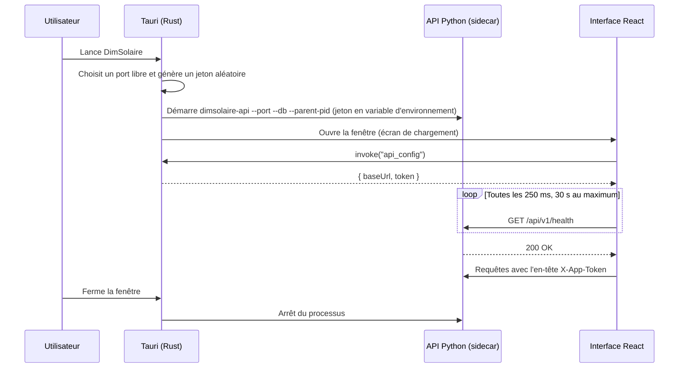

# DimSolaire — Architecture technique

> Architecture **hybride** : une seule base de code (React + FastAPI), livrée sous deux formes :
> **application PC Windows installable et utilisable hors ligne** (Tauri) et **application web** (navigateur).

| Élément | Valeur |
|---|---|
| Document | `ARCHITECTURE.md` — volet technique |
| Volet métier | [`CAHIER_DE_CHARGES.md`](CAHIER_DE_CHARGES.md) |
| Version | 1.0 |
| Date | 25 octobre 2026 |

## Sommaire

1. Vue d'ensemble
2. Modes d'exécution
3. Pile technique
4. Arborescence du dépôt
5. Configuration
6. Fonctionnement de la version PC
7. Fonctionnement de la version web
8. Sécurité
9. Conventions de code
10. Interface utilisateur et design system
11. Modèle de données et API
12. Rapport PDF
13. Build, packaging et déploiement
14. Plan de développement
15. Tests
16. État de l'installation

---

## 1. Vue d'ensemble

```
             VERSION PC (hors ligne)                          VERSION WEB (en ligne)
┌──────────────────────────────────────────┐    ┌──────────────────────────────────────────┐
│ DimSolaire.exe (Tauri, fenêtre WebView2)  │    │ Navigateur (PC, tablette, téléphone)      │
│  └─ Interface React (même code)           │    │  └─ Interface React (même code)           │
│        │ HTTP 127.0.0.1:<port aléatoire>  │    │        │ HTTPS (même origine)              │
│        ▼  + en-tête X-App-Token           │    │        ▼  + jeton JWT (phase 6)            │
│ dimsolaire-api.exe (sidecar)              │    │ Serveur : FastAPI (même code)              │
│  └─ FastAPI + moteur de calcul Python     │    │  └─ moteur de calcul Python               │
│  └─ SQLite : %APPDATA%\…\dimsolaire.db    │    │  └─ PostgreSQL                             │
└──────────────────────────────────────────┘    └──────────────────────────────────────────┘
                 ▲                                                  ▲
                 └──────── export / import de fichiers projet ──────┘
                            (.dimsolaire.json)
```

Le principe P6 du cahier des charges impose une base de code unique. Seul l'emballage change : Tauri enveloppe l'API dans un exécutable, Docker la sert derrière HTTPS.

## 2. Modes d'exécution

| Aspect | `dev` (développement) | `desktop` (version PC) | `web` (version en ligne) |
|---|---|---|---|
| Lancement | `uvicorn` + `npm run dev` | Installateur Windows `.exe` / `.msi` | URL dans un navigateur |
| Internet requis | Non | **Non** | Oui |
| Interface | Navigateur, `localhost:5173` | Fenêtre Tauri (WebView2) | Navigateur |
| API | `127.0.0.1:8000` | `127.0.0.1:<port libre>`, lancée par Tauri | Serveur HTTPS |
| Base de données | SQLite locale | SQLite dans `%APPDATA%` | PostgreSQL |
| Authentification | Aucune | Jeton local par session | Comptes utilisateurs (JWT), phase 6 |
| Migrations | Au démarrage | Au démarrage (automatique) | Étape de déploiement (`alembic upgrade head`) |
| Données PVGIS / NASA POWER (v2) | Si connexion | Si connexion (sinon saisie manuelle) | Oui |
| Mises à jour | — | Nouvel installateur (puis updater Tauri) | Immédiates |

## 3. Pile technique

| Couche | Technologie | Rôle | Remarque |
|---|---|---|---|
| Moteur de calcul | Python 3.12 | Toutes les formules et vérifications | Aucune dépendance lourde en v1 |
| Modèles de données | Pydantic 2 | Schémas d'entrée/sortie, validation, OpenAPI | Source unique des types |
| API | FastAPI + Uvicorn | Expose le moteur, les catalogues, les projets, le PDF | `create_app()` (fabrique) |
| Base de données | SQLAlchemy 2 + Alembic | ORM et migrations | SQLite (PC) / PostgreSQL (web) |
| Rapport PDF | ReportLab 4 | PDF et graphiques intégrés | **Pas de matplotlib** (alourdirait la version PC) |
| Interface | React 19 + TypeScript (strict) + Vite | Les 4 onglets | |
| Composants | MUI (Material UI) + MUI X Data Grid + MUI X Charts | Formulaires, tableaux éditables, graphiques | Versions communautaires (licence MIT) |
| État et requêtes | Zustand (+ immer) + TanStack Query | État du projet, appels API | |
| Routage | React Router, `createHashRouter` | Navigation | Le mode « hash » fonctionne à l'identique dans Tauri et sur un hébergement statique |
| Types TS | `openapi-typescript` | Types générés depuis l'OpenAPI de FastAPI | Évite les écarts front/back — **voir §14, conflit de versions** |
| Application PC | Tauri 2 (Rust) + plugins `shell`, `dialog`, `fs` | Fenêtre native, lancement de l'API, enregistrement de fichiers | Installateur léger |
| Exécutable de l'API | PyInstaller 6 | Compile FastAPI + moteur en `dimsolaire-api.exe` | Embarqué comme « sidecar » Tauri |
| Hébergement web | Docker, Render ou VPS | Une image contenant le build React et l'API | |
| Qualité | ruff, mypy (strict sur `engine/`), pytest ; ESLint, Prettier, Vitest | Lint, typage, tests | Intégration continue GitHub Actions |

pvlib, pandas et numpy ne sont **pas** utilisés en v1 : les calculs du cahier des charges n'en ont pas besoin, et ils multiplieraient la taille de l'exécutable PC (numpy seul ajoute environ 80 Mo à un build PyInstaller). pvlib sera ajouté en v2 pour la simulation avancée.

## 4. Arborescence du dépôt

```
dimsolaire/
├── CAHIER_DE_CHARGES.md
├── ARCHITECTURE.md
├── README.md
├── backend/
│   ├── pyproject.toml
│   ├── alembic.ini
│   ├── alembic/                    # migrations (compatibles SQLite et PostgreSQL)
│   ├── run_server.py               # point d'entrée du sidecar (PyInstaller)
│   ├── dimsolaire-api.spec         # configuration PyInstaller
│   ├── app/
│   │   ├── main.py                 # create_app() : FastAPI, CORS, jeton, routes, fichiers statiques
│   │   ├── config.py               # paramètres (pydantic-settings, variables d'environnement)
│   │   ├── engine/                 # MOTEUR DE CALCUL : Python pur, sans état, sans I/O
│   │   │   ├── constantes.py       # STC, sections, calibres, transformateurs, ρ, tables Iz
│   │   │   ├── unites.py           # conversions (GHI, surfaces, kWc/MWc, Wh/kWh…)
│   │   │   ├── arrondis.py         # ceil_safe, floor_safe, arrondi_demi_haut, normaliser
│   │   │   ├── messages.py         # Message, Niveau, catalogue des codes
│   │   │   ├── modeles.py          # schémas Pydantic d'entrée et de sortie
│   │   │   ├── potentiel.py        # Onglet 1
│   │   │   ├── bilan.py            # Onglet 2
│   │   │   ├── production.py       # Étapes 1 à 3
│   │   │   ├── champ_pv.py         # Étapes 4 à 11
│   │   │   ├── onduleur.py         # Étapes 12 à 14
│   │   │   ├── batteries.py        # Étapes 15 à 19
│   │   │   ├── cables.py           # Étapes 20, 21 et câble AC
│   │   │   ├── injection.py        # Onglet 4
│   │   │   └── pipeline.py         # calculer_projet() : enchaîne tous les modules
│   │   ├── api/v1/                 # routes : health, calcul, catalogue, projets, rapports
│   │   ├── db/                     # modèles SQLAlchemy, session, init, seed/*.json
│   │   ├── services/               # projets, import/export, génération PDF
│   │   └── rapports/               # mise en page ReportLab
│   └── tests/
│       ├── engine/                 # tests unitaires et cas de référence R-01 à R-04
│       └── api/                    # tests des routes
├── frontend/
│   ├── package.json
│   ├── vite.config.ts
│   ├── src/
│   │   ├── main.tsx
│   │   ├── App.tsx
│   │   ├── theme/                  # design tokens, thème MUI clair et sombre
│   │   ├── api/                    # client HTTP, config (Tauri ou web), types générés
│   │   ├── store/                  # état du projet (Zustand)
│   │   ├── features/
│   │   │   ├── potentiel/
│   │   │   ├── bilan/
│   │   │   ├── dimensionnement/    # sous-onglets : production, panneaux, onduleur, batteries, câbles
│   │   │   ├── injection/
│   │   │   ├── projets/
│   │   │   └── catalogue/
│   │   ├── components/             # NumberField, UnitToggle, PanneauValidation, SchemaSerieParallele…
│   │   └── utils/                  # formatage fr-FR, mise à l'échelle des unités
│   └── src-tauri/                  # VERSION PC
│       ├── Cargo.toml
│       ├── tauri.conf.json
│       ├── capabilities/default.json
│       ├── binaries/               # dimsolaire-api-x86_64-pc-windows-msvc.exe (généré, non versionné)
│       └── src/
│           ├── main.rs
│           └── lib.rs
├── scripts/
│   ├── build_sidecar.ps1           # compile l'API Python et la copie dans src-tauri/binaries
│   └── build_desktop.ps1           # build_sidecar + tauri build
├── Dockerfile                      # VERSION WEB (build React + API dans une seule image)
└── .github/workflows/ci.yml
```

## 5. Configuration

| Variable | Valeurs | Défaut | Rôle |
|---|---|---|---|
| `DIMSOLAIRE_MODE` | `dev`, `desktop`, `web` | `dev` | Comportement de l'API (§2) |
| `DATABASE_URL` | `sqlite:///…` ou `postgresql+psycopg://…` | `sqlite:///./dimsolaire.db` | Connexion à la base |
| `DIMSOLAIRE_TOKEN` | chaîne aléatoire | vide | Jeton exigé en mode `desktop` (fourni par Tauri) |
| `DIMSOLAIRE_CORS` | liste d'origines séparées par des virgules | `http://localhost:5173` | Origines autorisées |
| `DIMSOLAIRE_SECRET_KEY` | chaîne secrète | — | Signature des JWT (mode `web`) |
| `DIMSOLAIRE_STATIC_DIR` | chemin | `./static` | Build React servi par FastAPI (mode `web`) |
| `DIMSOLAIRE_LOG_FILE` | chemin | — | Fichier journal (mode `desktop`) |
| `VITE_API_URL` (frontend) | URL | `http://127.0.0.1:8000` en dev ; vide en web | Adresse de l'API hors Tauri |

En mode `desktop`, les origines CORS à autoriser sont `http://tauri.localhost` et `https://tauri.localhost` (Windows) ainsi que `tauri://localhost` (macOS et Linux).

Aucune valeur secrète n'est écrite en dur : `DIMSOLAIRE_SECRET_KEY` et `DIMSOLAIRE_TOKEN` viennent toujours de l'environnement.

## 6. Fonctionnement de la version PC



Règles de robustesse :

1. **Port** : Tauri réserve un port libre (`127.0.0.1:0`), le libère puis le transmet à l'API. Le risque de conflit est négligeable.
2. **Arrêt garanti** : Tauri arrête l'API à la fermeture. En plus, l'API surveille le PID de Tauri (`--parent-pid`, via `psutil`) et s'arrête seule si Tauri disparaît (plantage), pour ne jamais laisser de processus orphelin.
3. **Journal** : la sortie de l'API est lue par Tauri et écrite dans `%APPDATA%\cm.dimsolaire.app\logs\`. Ne pas lire la sortie peut bloquer le processus Python.
4. **Échec de démarrage** : si `/health` ne répond pas en 30 s, l'interface affiche « Le moteur de calcul n'a pas pu démarrer » avec un bouton « Réessayer » et le chemin du journal.
5. **Base locale** : `%APPDATA%\cm.dimsolaire.app\dimsolaire.db`. Elle est créée et migrée automatiquement, et les catalogues sont chargés au premier lancement.
6. **WebView2** : présent sur Windows 11 et la plupart des Windows 10 à jour. Pour les installations sur le terrain sans internet, produire une variante d'installateur avec le runtime WebView2 intégré.

## 7. Fonctionnement de la version web

- Une seule image Docker : FastAPI sert l'API sous `/api/v1/…` et le build React sous `/`. Interface et API ont la même origine, donc pas de problème de CORS.
- Base PostgreSQL gérée (Render, ou PostgreSQL installé sur un VPS).
- Les migrations sont exécutées au déploiement (`alembic upgrade head`), pas au démarrage de chaque processus.
- En phase 6 : comptes utilisateurs. Chaque projet et chaque équipement personnalisé appartient à un utilisateur ; les catalogues système sont partagés et en lecture seule.

## 8. Sécurité

| Mode | Mesures |
|---|---|
| `desktop` | API liée à `127.0.0.1` uniquement ; port aléatoire ; jeton aléatoire par session exigé dans l'en-tête `X-App-Token` (sauf `/health` et requêtes `OPTIONS`) ; CSP Tauri limitant les connexions à `http://127.0.0.1:*` ; aucune donnée envoyée sur internet |
| `web` | HTTPS obligatoire ; authentification JWT ; mots de passe hachés (Argon2) ; CORS restreint ; limitation du nombre de requêtes ; sauvegarde quotidienne de PostgreSQL |
| Les deux | Validation de toutes les entrées (Pydantic) ; import de projet validé contre le schéma ; aucune exécution de contenu importé |

## 9. Conventions de code

- Vocabulaire métier en français (`pc_kwc`, `tension_systeme_v`, `calculer_bilan`). Les clés du catalogue reprennent exactement celles du cahier des charges (`pmax`, `vmp`, `voc`, `imp`, `isc`, `coef_voc`, `pnom_ac`, `vmppt_min`…).
- Python : ruff (lint et formatage), mypy strict sur `engine/`, docstrings citant les formules (`"""F-09 : Pc = E / (Ir × PR)."""`).
- TypeScript : mode strict, ESLint et Prettier. Les types d'API sont générés et jamais écrits à la main.
- Couverture de tests du moteur : au moins 90 %.
- Messages de commit : convention « Conventional Commits » (`feat:`, `fix:`, `test:`…).

### Pourquoi le moteur est isolé

Le principe P1 impose que `engine/` n'importe ni FastAPI, ni SQLAlchemy, ni rien qui touche au réseau ou au disque. Conséquences pratiques :

- le moteur est testable sans serveur ni base, donc les tests sont rapides et déterministes ;
- mypy peut tourner en mode strict sur ce seul dossier, là où la valeur est la plus grande ;
- le même code sert l'API web, le sidecar PyInstaller et les tests, sans adaptation ;
- un changement de framework HTTP ne toucherait pas une ligne de calcul.

La règle est vérifiable automatiquement : aucun `import` de `engine/` ne doit sortir de la bibliothèque standard et de Pydantic.

## 10. Interface utilisateur et design system

### 10.1 Design tokens

Les tokens sont définis une seule fois et consommés par le thème MUI. Palette restreinte : un accent, des neutres, quatre sémantiques.

| Rôle | Clair | Sombre | Usage |
|---|---|---|---|
| `bg` | `#f4f6f8` | `#0d151e` | Fond de page |
| `surface` | `#ffffff` | `#141f2b` | Cartes, tableaux |
| `surface-sunk` | `#eceff3` | `#101922` | En-têtes de tableau, champs en lecture seule |
| `rail` | `#16202c` | `#0a1118` | Rail de navigation |
| `fg` | `#16202c` | `#e4ebf1` | Texte principal |
| `fg-muted` | `#55687a` | `#9aabb9` | Libellés, texte secondaire |
| `fg-faint` | `#8396a7` | `#6e818f` | Aides, texte tertiaire |
| `line` | `#d9e0e7` | `#243444` | Bordures |
| `accent` | `#b86e00` | `#f0ad3e` | Ambre solaire : accent unique |
| `err` | `#b3261e` | `#ff9a92` | Niveau `erreur` |
| `warn` | `#8a5a00` | `#f3bf5e` | Niveau `avertissement` |
| `info` | `#15616d` | `#6fd0dd` | Niveau `info` |
| `ok` | `#1b5e3f` | `#71d19e` | Statut conforme |

Choix et contraintes :

- **L'accent ambre est distinct des quatre sémantiques.** Si l'accent était orange, un avertissement se confondrait avec un chiffre mis en avant.
- **Les neutres sont biaisés vers le bleu**, pas en gris pur : un gris neutre paraît non choisi.
- **Le mode sombre n'est pas une inversion** : les sémantiques sont désaturées et éclaircies pour rester lisibles sur fond sombre, et leurs fonds sont des teintes très sombres, pas les mêmes fonds assombris.
- Tous les couples texte/fond visent au minimum WCAG AA (4,5:1 pour le texte courant).

### 10.2 Typographie

Trois rôles, deux familles de texte plus une à chasse fixe :

| Token | Famille | Usage |
|---|---|---|
| `--f-display` | Archivo | Titres, grands nombres des tuiles de résultat |
| `--f-body` | Public Sans | Corps de texte, libellés, boutons |
| `--f-mono` | JetBrains Mono | Formules, codes de message (`PV-E04`), colonnes de chiffres |

Règles :
- hauteur de ligne d'environ 1,55 pour le texte courant ;
- lignes limitées à 62 caractères (`max-width: 62ch`) pour les paragraphes explicatifs ;
- `font-variant-numeric: tabular-nums` partout où des chiffres s'alignent en colonne — indispensable pour comparer des tensions ou des courants ;
- taille minimale de 16 px pour les champs de saisie, afin d'éviter le zoom automatique sur iOS.

### 10.3 Espacements, rayons, durées

- Grille d'espacement de 4 px, valeurs usuelles : 4, 8, 12, 16, 20, 24, 32, 44.
- Rayons : 4 px (petits éléments), 7 px (boutons, champs), 11 px (cartes).
- Durées d'animation : 180 ms pour les retours d'interaction, 250 ms maximum. `prefers-reduced-motion` est respecté par une règle globale.

### 10.4 Responsive

Approche mobile-first, vérifiée à 320, 375, 414, 768, 1024, 1280, 1440 et 1920 px.

| Seuil | Comportement |
|---|---|
| < 920 px | Le rail de navigation devient un tiroir, ouvert par un bouton hamburger. Barre supérieure fixe avec le statut global |
| < 760 px | Les grilles à deux colonnes passent à une colonne |
| Toutes largeurs | Gouttière latérale d'au moins 16 px, écrite `max(16px, env(safe-area-inset-left, 0px))` pour tenir compte des encoches |
| Tableaux | Conteneur à défilement horizontal propre (`overflow-x: auto`), jamais de défilement de la page |
| Grands écrans | Largeur de contenu limitée à 1 180 px pour rester lisible |

Autres règles :
- zones tactiles d'au moins 44 × 44 px (steppers Ns/Np, boutons du rail) ;
- `dvh` plutôt que `vh` ;
- aucune largeur ni hauteur fixe en pixels sur les conteneurs : Grid et Flexbox avec `minmax()` et `auto-fit` ;
- typographie fluide avec `clamp()` sur les titres et les grands nombres.

### 10.5 États des composants

Chaque composant prévoit : normal, survol, focus, actif, désactivé, chargement, vide, erreur, succès.

- **Focus visible et stylé** partout (`outline: 2px solid var(--accent); outline-offset: 2px`), jamais supprimé.
- **Chargement** : squelettes pour les tableaux et les tuiles, pas de spinner plein écran après le démarrage.
- **Vide** : un état vide nomme toujours ce qui manque et comment le remplir. L'onglet 4 sans onduleur affiche la cause (`INJ-E04`) et un bouton qui mène à l'onglet 3.
- **Erreur** : le niveau d'un message se lit à la couleur, à l'icône **et** au code — jamais à la couleur seule.

### 10.6 Composants transverses

| Composant | Rôle |
|---|---|
| `NumberField` | Saisie numérique acceptant la virgule et le point, formatage `fr-FR` à la perte du focus, `inputmode="decimal"` |
| `UnitToggle` | Bascule d'unité accolée au champ (W/m², kWh/m²/j, kWh/m²/an ; m², ha, km² ; kWc, MWc) |
| `PanneauValidation` | Liste des messages du moteur, groupés par niveau, avec bouton d'action quand une suggestion est applicable |
| `SchemaSerieParallele` | Schéma SVG du champ avec steppers + / − sur Ns et Np |
| `TuileResultat` | Tuile valeur + unité + note, avec mise à l'échelle automatique des unités |
| `FormuleAffichee` | Affichage d'une formule avec son identifiant `F-xx` |

### 10.7 Maquette de référence

Une maquette navigable des quatre onglets est disponible, avec les chiffres réels des cas de référence R-01 à R-04. Elle sert de référence visuelle pour l'implémentation React.

## 11. Modèle de données et API

### 11.1 Principes

- Les schémas Pydantic de `engine/modeles.py` sont la source unique. Ils servent à l'API, à la base (colonne JSON), à l'export et aux types TypeScript générés.
- `ProjetEntree` est autoporteur : les fiches sont copiées dans le projet (P2).
- Le calcul est une fonction pure : `calculer_projet(entree) -> ResultatsProjet`.
- Pydantic ne valide que les types. Les bornes métier produisent des messages.

### 11.2 Entrée `ProjetEntree` (version_schema = 1)

```
ProjetEntree
├── meta: nom, zone ("Yaoundé Ouest"), auteur, notes, version_schema
├── potentiel: PotentielEntree
├── bilan: profils[ {id, nom, nb_abonnes, lignes[LigneEquipement]} ]
├── production: taux_couverture, performance_ratio, critere_ir, mode_pc,
│               pc_imposee_kwc, tension_systeme_v
├── pv: fiche (Panneau | null), mode_config, tension_reference_ns, ns_manuel,
│       np_manuel, t_amb_min_c, t_amb_max_c, g_ref_w_m2
├── onduleur: OnduleurEntree
├── batteries: BatteriesEntree
├── cables: rho_mode, rho_perso_cu, rho_perso_al,
│           dc_principal | dc_chaine | dc_batteries:
│           {materiau, longueur_m, epsilon, k_correction}
└── injection: InjectionEntree
```

Un champ facultatif absent prend la valeur par défaut de la spécification. `GET /api/v1/projets/defaut` renvoie un projet complet par défaut.

### 11.3 Sortie `ResultatsProjet`

```
ResultatsProjet
├── version_moteur, horodatage, statut_global
├── messages: Message[]
└── potentiel | bilan | production | pv | onduleur | batteries | cables | injection:
    { statut: "ok" | "avertissement" | "erreur" | "non_calcule", valeurs: {...} | null }
```

- Valeurs de `production` : `ir_kwh_m2_j`, `e_cible_kwh_j`, `pc_calculee_kwc`, `pc_retenue_kwc`, `prod_theorique` et `prod_installee` ({`mensuel_kwh`[12], `an_kwh`, `j_kwh`, `y_kwh_kwc`}), `taux_couverture_effectif`.
- Valeurs de `pv` : `n_min`, `ns`, `np`, `n_total`, `pc_installee_kwc`, `u_dc_v`, `i_dc_a`, `i_cc_dc_a`, `u_co_v`, `t_cell_min_c`, `t_cell_max_c`, `voc_max_v`, `vmp_min_v`, `vmp_max_v`.
- Autres modules : voir les sections correspondantes du cahier des charges.

### 11.4 Base de données (SQLAlchemy 2 ; SQLite ou PostgreSQL)

| Table | Colonnes principales |
|---|---|
| `projets` | id (UUID), nom, zone, entree (JSON), resultats (JSON, cache), version_schema, proprietaire_id (null en PC), cree_le, modifie_le |
| `panneaux`, `onduleurs`, `batteries`, `equipements` | id (slug), nom, fabricant, colonnes de filtre (pmax, pnom_ac, u_nom…), fiche (JSON), source (`systeme` ou `utilisateur`), proprietaire_id, actif |
| `utilisateurs` (web, phase 6) | id, email (unique), mot_de_passe_hash (Argon2), nom, cree_le |
| `meta` | cle, valeur (versions du seed et du schéma) |

- Colonnes JSON : `JSON().with_variant(JSONB, "postgresql")`.
- Migrations : Alembic avec `render_as_batch=True` (nécessaire pour SQLite).
- Seed : au démarrage, si sa version a changé, seules les fiches `systeme` sont mises à jour.

### 11.5 Format d'export `.dimsolaire.json`

```json
{"format": "dimsolaire-projet", "version_format": 1, "version_logiciel": "1.0.0",
 "exporte_le": "2026-10-25T10:00:00Z",
 "projet": {"...": "ProjetEntree"},
 "resultats": {"...": "facultatif"},
 "empreinte": "sha256:<hex>"}
```

**Import**
1. Vérifier `format` et `version_format`, et migrer si la version est ancienne.
2. Valider `projet`, puis recalculer. Les `resultats` importés ne servent qu'à la comparaison.
3. Attribuer un nouvel id ; ajouter le suffixe « (importé) » si le nom existe déjà.
4. Contrôler l'empreinte : SHA-256 du JSON canonique de `projet` (clés triées, sans espaces). Si elle diffère, afficher un avertissement et importer quand même.

Interface : boîtes de dialogue Tauri en version PC (plugins `dialog` et `fs`) ; téléchargement et `<input type="file">` en version web.

### 11.6 Routes (préfixe `/api/v1`)

| Méthode et route | Entrée → sortie |
|---|---|
| GET `/health` | → {statut, version, mode} (sans jeton) |
| POST `/calcul` | ProjetEntree → ResultatsProjet |
| POST `/selection/{panneaux, onduleurs, batteries}` | {projet, filtres} → [{fiche, apercu, statut, motif}] |
| GET `/catalogue/{type}` ; GET `/catalogue/{type}/{id}` | filtres en paramètres → fiches |
| POST, PUT, DELETE `/catalogue/{type}[/{id}]` | fiches utilisateur |
| GET `/projets/defaut` | → ProjetEntree par défaut |
| GET, POST `/projets` ; GET, PUT, DELETE `/projets/{id}` | liste, création, lecture, enregistrement (avec recalcul et cache), suppression |
| POST `/projets/{id}/dupliquer` | → nouveau projet |
| GET `/projets/{id}/export` ; POST `/projets/import` | fichier `.dimsolaire.json` |
| POST `/rapports/pdf` ; GET `/projets/{id}/rapport.pdf` | → PDF |
| POST `/auth/inscription`, `/auth/connexion` (web) | → JWT |

Codes HTTP : 200, 201, 204, 401 (jeton), 404, 409 (conflit d'identifiant), 422 (types). `/calcul` ne renvoie **jamais** d'erreur pour une valeur métier : il renvoie des messages (principe P3).

### 11.7 Stratégie de calcul côté interface

- Chaque modification met à jour l'état (Zustand), puis appelle `POST /calcul` après 300 ms sans saisie. Seule la dernière requête compte (TanStack Query).
- Les résultats partiels sont toujours affichés.
- Enregistrement explicite (Ctrl+S) et automatique toutes les 60 s.

## 12. Rapport PDF (ReportLab, A4)

**Contenu**
1. Page de garde : projet, zone, auteur, date, versions du logiciel et du moteur.
2. Synthèse : Pc installée, panneaux, onduleurs, batteries, transformateurs, énergie injectée, statut global.
3. Hypothèses et données : GHI et sa source, surface, PR, températures, hypothèses H-01 à H-04, corrections C-xx appliquées.
4. Potentiel solaire.
5. Bilan énergétique : tableaux par catégorie et totaux.
6. Dimensionnement : production mensuelle (graphique), panneaux et configuration (schéma série/parallèle simplifié), onduleurs (critères), batteries, câbles DC.
7. Injection : transformateur, câble AC, disjoncteur, bilan mensuel et indicateurs.
8. Vérifications : tous les messages, triés par niveau.
9. Annexes : formules F-xx utilisées, fiches des équipements choisis.

**Règles**
- Nombres au format fr-FR.
- Police DejaVu Sans embarquée, pour les symboles √, ≤, ⌈ et ⌉.
- Graphiques avec `reportlab.graphics`.
- Pied de page « DimSolaire – page X / Y ».
- Le PDF est produit à partir du résultat du moteur et n'est jamais recalculé ailleurs.

## 13. Build, packaging et déploiement

### 13.1 Développement

```bash
cd backend && python -m venv .venv && .venv\Scripts\activate && pip install -e ".[dev]"
uvicorn app.main:create_app --factory --reload --port 8000
cd frontend && npm install && npm run dev
npx openapi-typescript http://127.0.0.1:8000/openapi.json -o src/api/schema.d.ts
```

Dépendances du backend :
- de base : fastapi, uvicorn, pydantic, pydantic-settings, sqlalchemy, alembic, reportlab, psutil ;
- développement : pytest, pytest-cov, hypothesis, httpx, ruff, mypy, pyinstaller ;
- version web : psycopg[binary], argon2-cffi, pyjwt.

### 13.2 Version PC (Windows) — `scripts/build_desktop.ps1`

1. `pyinstaller dimsolaire-api.spec` produit `dist/dimsolaire-api.exe`, en mode onefile, avec :
   - `hiddenimports` : `uvicorn.logging`, `uvicorn.loops.auto`, `uvicorn.protocols.http.auto`, `uvicorn.lifespan.on` ;
   - `datas` : `alembic/`, `alembic.ini`, `app/db/seed/`, `app/rapports/fonts/`.
2. Copier l'exécutable vers `frontend/src-tauri/binaries/dimsolaire-api-<triplet>.exe`. Le triplet est donné par la ligne `host` de `rustc -vV` (par exemple `x86_64-pc-windows-msvc`).
3. `npm run tauri build` produit les installateurs NSIS (`.exe`) et MSI.

Réglages de `tauri.conf.json` :
- `identifier` : `"cm.dimsolaire.app"` ;
- `bundle.externalBin` : `["binaries/dimsolaire-api"]` ;
- `bundle.targets` : `["nsis", "msi"]` ;
- `bundle.windows.webviewInstallMode` : `{"type": "offlineInstaller"}` pour la variante terrain sans internet, sinon `downloadBootstrapper` ;
- `app.security.csp` : `"default-src 'self'; connect-src 'self' http://127.0.0.1:*; img-src 'self' data:; style-src 'self' 'unsafe-inline'"`.

Plugins Rust : `tauri-plugin-shell`, `tauri-plugin-dialog` et `tauri-plugin-fs`. Capacités : `core:default`, `dialog:default` et `fs:default`. Le sidecar est lancé côté Rust : aucune permission shell n'est nécessaire côté JavaScript. La signature de code est recommandée : elle évite les alertes SmartScreen et antivirus.

### 13.3 Version web

- `Dockerfile` en deux étapes :
  1. `node:22` : `npm ci && npm run build` ;
  2. `python:3.12-slim` : installation du backend, copie de `frontend/dist` vers `/app/static`, puis `CMD ["uvicorn", "app.main:create_app", "--factory", "--host", "0.0.0.0", "--port", "8000"]`.
- Déploiement au choix : Render (service web + PostgreSQL, commande de pré-déploiement `alembic upgrade head`) ou VPS (Docker Compose et Caddy pour le HTTPS).
- Variables : `DIMSOLAIRE_MODE=web`, `DATABASE_URL`, `DIMSOLAIRE_SECRET_KEY`, `DIMSOLAIRE_CORS`.
- Sauvegarde quotidienne de PostgreSQL.

### 13.4 Intégration continue (GitHub Actions)

- À chaque push : ruff, mypy et pytest pour le backend ; lint, Vitest et build pour le frontend.
- Sur une étiquette `v*` : un job `windows-latest` construit le sidecar et les installateurs, puis les publie dans la release.
- Une seule version (SemVer), reportée dans `pyproject.toml`, `package.json`, `tauri.conf.json` et `Cargo.toml`.

## 14. Plan de développement

| Phase | Contenu | Critère de fin | Durée indicative (seul) |
|---|---|---|---|
| 0 | Dépôt, arborescence, CI, conventions | CI verte sur un projet vide | 3 jours |
| 1 | Moteur : unités, arrondis, messages, tous les modules | R-01 à R-11 passent ; couverture ≥ 90 % | 3 semaines |
| 2 | API, base, seed, sélection, projets, export/import | Tests API verts ; OpenAPI complet | 2 semaines |
| 3 | Interface React : 4 onglets, vérifications, projets, catalogue | Parcours complet R-01 à R-10 dans le navigateur | 4 semaines |
| 4 | Rapport PDF | PDF conforme au §12 pour R-10 | 1 semaine |
| 5 | Version PC : sidecar, Tauri, installateurs | Installation et calcul sur un PC Windows sans internet | 1 semaine |
| 6 | Version web : Docker, déploiement, comptes | Application en ligne en HTTPS avec comptes | 2 semaines |
| 7 | Validation et recette | Comparaison PVsyst/PVGIS documentée ; questions Q-xx tranchées | 1 semaine |

**État actuel : phase 0 en cours.** Arborescence et dépendances installées ; maquette validée ; CI à écrire.

Évolutions prévues en v2 : simulation horaire et transposition (pvlib), import PVGIS et NASA POWER, ombrages, protections DC et mise à la terre, partie HTA et courts-circuits, étude économique complète, synchronisation PC/web, stockage haute tension.

## 15. Tests

**Règles** : un fichier pytest par module ; tolérance relative de 10⁻⁶ sur les réels ; égalité stricte sur les entiers et les codes de messages ; couverture d'au moins 90 % sur `engine/`.

- **Cas de référence R-01 à R-11** : voir le §9 du cahier des charges.
- **Arrondis** : `ceil_safe((0,1 + 0,2) / 0,1) = 3` ; `floor_safe(69,3 / 23,1) = 3` ; `arrondi_demi_haut(2,5) = 3`.
- **Propriétés** (hypothesis) : N_total ≥ N_min ; Ns × U_ref ≤ Us ; n × Iz ≥ I_B ; E_inj ≤ E_prod.
- **Messages** : chaque code est déclenché au moins une fois.
- **API** (TestClient) : `/health`, chaîne de calcul R-01 à R-10, aller-retour export/import, réponse 401 sans `X-App-Token` en mode desktop.
- **Interface** : Vitest (formatage fr-FR, `NumberField`) ; Playwright (parcours complet en version web).
- **Validation externe** : production annuelle comparée à PVsyst ou PVGIS sur deux projets (écart attendu inférieur à 5 % après ajustement du PR), documentée dans `docs/validation.md`.

## 16. État de l'installation et de la recette

Relevé du 25 octobre 2026.

### 16.0 Ce qui est vérifié, et ce qui ne l'est pas

| Élément | État | Vérification |
|---|---|---|
| Moteur de calcul (14 modules) | ✅ écrit | 98 tests passent ; cas R-01 à R-11 exacts |
| Typage strict du moteur | ✅ | `mypy app/engine/` : aucune erreur sur 15 fichiers |
| Lint Python | ✅ | `ruff check app/` : aucune remarque |
| API FastAPI (20 routes) | ✅ écrite | Tests TestClient, dont jeton `desktop` et aller-retour export/import |
| Base et catalogues | ✅ | 14 panneaux, 7 onduleurs, 10 batteries, 22 appareils chargés |
| Rapport PDF | ✅ | Produit en 9 sections, environ 21 ko ; testé sur R-10 et sur un projet vide |
| Interface React (4 onglets) | ✅ écrite | Lint propre, build à 275 ko (82 ko compressés) |
| Exécutable PyInstaller | ✅ testé | 36 Mo, démarrage en 4,4 s, recette `verif_sidecar.py` |
| Version autonome (un seul `.exe`) | ✅ testée | Recette `verif_autonome.py` : API et interface servies ensemble |
| Lanceurs `.bat` | ✅ écrits | **Non exécutés de bout en bout** |
| Projet Tauri (Rust) | ✅ écrit | **Jamais compilé** : `npm run tauri build` non lancé |
| `Dockerfile` et `docker-compose.yml` | ✅ écrits | **Jamais construits** : Docker absent du poste |
| CI GitHub Actions | ✅ écrite | **Jamais exécutée** : pas de dépôt distant |
| Comptes utilisateurs (phase 6) | ❌ | Non écrits. **La version web ne doit pas être exposée publiquement** |

### 16.1 Outils du poste de développement

| Élément | Version | État |
|---|---|---|
| Node | 24.19.0 | Installé |
| npm | 11.17.0 | Installé |
| Git | 2.55.0 | Installé |
| Python | 3.12.10 | Installé (`%LOCALAPPDATA%\Programs\Python\Python312`) |
| Rust / rustup | — | Installé |
| Vite | 8.3.4 | Installé |
| React | 19.3.1 | Installé |
| TypeScript | 6.0.3 | Installé |
| MUI + X Data Grid + X Charts | — | Installé |
| Zustand, immer, TanStack Query, React Router | — | Installé |
| ESLint, Prettier, Vitest, Testing Library | — | Installé |
| FastAPI, Pydantic 2, SQLAlchemy 2, Alembic | — | Installé (venv `backend/.venv`) |
| ReportLab, psutil | — | Installé |
| ruff, mypy, pytest, pytest-cov, httpx | — | Installé |
| PyInstaller | 6.22.3 | Installé |
| Pillow | — | Installé (dépendance obligatoire de ReportLab 4) |
| `openapi-typescript` | 7.13.0 | **Non installé** — voir ci-dessous |

### Conflit `openapi-typescript`

`openapi-typescript@7.13.0` déclare `peer typescript@^5.x`, alors que Vite 8 installe TypeScript 6.0.3. L'installation échoue avec `ERESOLVE`.

Ce paquet ne sert qu'à générer les types TypeScript depuis l'OpenAPI de FastAPI, ce qui n'est utile qu'une fois les routes écrites. Trois options, à trancher à ce moment-là :

1. attendre une version compatible TypeScript 6 (préférable) ;
2. installer avec `--legacy-peer-deps` et vérifier que la génération fonctionne malgré tout ;
3. lancer la génération par `npx openapi-typescript` sans l'ajouter aux dépendances, ce qui évite le conflit d'arbre.

Aucune de ces options ne bloque le développement actuel.

### Tauri

La toolchain Rust est installée, mais le projet `src-tauri/` n'est pas encore initialisé : la maquette et le développement de l'interface se font dans le navigateur avec Vite. L'initialisation Tauri est prévue à la phase de packaging.
