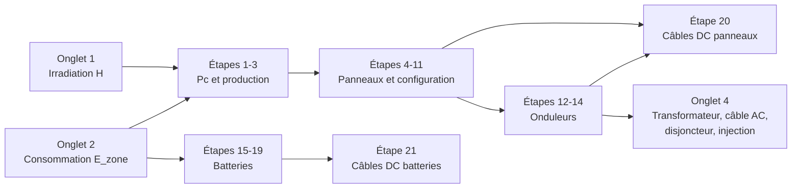

# DimSolaire — Cahier des charges

> Logiciel de dimensionnement photovoltaïque et d'injection au réseau
> Zone d'étude : **Yaoundé Ouest (Cameroun)**

| Élément | Valeur |
|---|---|
| Document | `CAHIER_DE_CHARGES.md` — volet métier |
| Volet technique | [`ARCHITECTURE.md`](ARCHITECTURE.md) |
| Version | 1.0 |
| Date | 25 octobre 2026 |
| Statut | Base de travail. Les points **[À VALIDER]** sont à confirmer avec l'encadrant |
| Couverture | §1 à §17 de la spécification (fin de §17 et §18-§20 à compléter) |

## Comment utiliser ce document

- Ce document et `ARCHITECTURE.md` forment la **source de vérité**. Toute formule, tout seuil et tout message d'erreur du code doivent s'y retrouver, et inversement.
- Chaque exigence porte un identifiant `EX-…`, repris dans la matrice de traçabilité.
- Chaque formule porte un identifiant `F-xx`. Le code le cite en docstring et le rapport PDF l'affiche.
- Chaque message de vérification porte un code (`PV-E03`, `OND-A01`…). La lettre indique le niveau : **E** = erreur, **A** = avertissement, **I** = information.
- Les écarts avec le cahier des charges d'origine sont listés et justifiés au §3.

## Sommaire

1. Présentation du projet
2. Conventions métier (unités, arrondis, affichage, messages)
3. Corrections et compléments apportés au cahier des charges d'origine
4. Module 1 — Potentiel solaire (Onglet 1)
5. Module 2 — Bilan énergétique (Onglet 2)
6. Module 3 — Dimensionnement technique (Onglet 3, étapes 1 à 21)
7. Module 4 — Injection au réseau (Onglet 4)
8. Catalogues et données de référence
9. Cas de référence — table de validation
10. Anomalies relevées dans la spécification
11. Questions ouvertes
12. Glossaire

---

## 1. Présentation du projet

### 1.1 Objectif

Développer un logiciel qui aide un ingénieur à concevoir une centrale solaire photovoltaïque pour une zone donnée (Yaoundé Ouest), puis à dimensionner son raccordement au réseau. Le logiciel comporte **quatre onglets principaux** :

| Onglet | Rôle | Question traitée |
|---|---|---|
| 1. Potentiel solaire | Évaluer l'énergie solaire disponible sur la zone | Combien de soleil la zone reçoit-elle ? |
| 2. Bilan énergétique | Évaluer la consommation de la zone | Combien d'énergie la zone consomme-t-elle ? |
| 3. Dimensionnement technique | Panneaux, configuration série/parallèle, onduleurs, batteries, câbles DC | Quel matériel, et comment le câbler ? |
| 4. Injection | Transformateur BT/HTA, câble AC, disjoncteur, étude de l'injection | Comment injecter l'énergie sur le réseau ? |

### 1.2 Périmètre

**Inclus en version 1 :**
- toutes les exigences du cahier des charges (onglets 1 à 4, étapes 1 à 21, injection) ;
- les vérifications automatiques avec messages d'erreur clairs ;
- la gestion des projets (créer, enregistrer, dupliquer, supprimer) ;
- l'export et l'import des projets sous forme de fichier ;
- le rapport PDF de dimensionnement ;
- les deux formes de livraison : PC hors ligne et web.

**Exclus de la version 1 (évolutions prévues) :**
- simulation horaire (pvlib), ombrages, transposition sur plan incliné ;
- étude économique détaillée (une option simple de recettes est prévue) ;
- protections DC (fusibles de chaîne, parafoudres) et mise à la terre ;
- partie HTA (câbles, cellules de protection, calcul de courant de court-circuit) ;
- synchronisation automatique des projets entre PC et web (remplacée par l'export/import) ;
- stockage haute tension (BESS de plusieurs centaines de volts).

### 1.3 Utilisateurs

| Profil | Besoin principal |
|---|---|
| Ingénieur / bureau d'études | Dimensionnement complet, rapport PDF pour le client |
| Technicien de terrain | Saisie rapide sur PC portable, **sans connexion internet** |
| Étudiant / encadrant | Vérification des formules, traçabilité, démonstration |

### 1.4 Principes directeurs

| Code | Principe | Conséquence concrète |
|---|---|---|
| P1 | **Moteur de calcul unique**, en Python pur, sans état | Le dossier `engine/` n'importe ni FastAPI, ni la base, ni l'interface. Il est testé seul. |
| P2 | **Projet autoporteur** | L'entrée de calcul contient les fiches complètes des équipements choisis (pas seulement leurs identifiants). Les résultats sont reproductibles et l'export/import est fiable. |
| P3 | **Ne jamais bloquer l'utilisateur** | Une valeur hors plage produit un message explicite, jamais un plantage. Le moteur calcule tout ce qui peut l'être. |
| P4 | **Unités explicites** | Suffixe d'unité dans les noms de variables. Conversions centralisées dans `unites.py`. |
| P5 | **Traçabilité** | Chaque formule a un identifiant `F-xx`, cité dans le code, les tests et le rapport. |
| P6 | **Une seule base de code** | Le même React et le même FastAPI servent la version PC et la version web. Seul l'emballage change. |

---

## 2. Conventions métier

### 2.1 Unités internes

| Grandeur | Unité interne | Suffixe | Exception documentée |
|---|---|---|---|
| Puissance | W | `_w` | `pc_kwc` (kWc) pour la puissance crête ; `pnom_ac` des onduleurs en **kW** (clé du cahier des charges) |
| Énergie | Wh | `_wh` | Résultats affichés en kWh, MWh, GWh |
| Tension | V | `_v` | Clés du catalogue sans suffixe (`vmp`, `voc`…) |
| Courant | A | `_a` | Clés du catalogue sans suffixe (`imp`, `isc`…) |
| Irradiation | kWh/m²/jour | `_kwh_m2_j` | |
| Irradiance | W/m² | `_w_m2` | |
| Longueur | m | `_m` | |
| Section | mm² | `_mm2` | |
| Température | °C | `_c` | |
| Coefficients de température | %/°C | `coef_…` | Valeurs négatives |
| Ratios, rendements, Ks, DoD, ε | sans unité, de 0 à 1 | — | Affichés en % dans l'interface |
| Puissance apparente | kVA | `_kva` | |

**Règle importante** : l'irradiation journalière en kWh/m²/j est numériquement égale au nombre d'heures équivalentes de plein soleil (h/j), car l'éclairement de référence STC vaut 1 kW/m². C'est ce qui rend la formule `Pc = E / (Ir × PR)` homogène.

### 2.2 Arrondis

| Fonction | Usage | Règle |
|---|---|---|
| `ceil_safe(x)` | Nombres de panneaux, de batteries, d'onduleurs, de chaînes | Arrondi supérieur, mais une valeur à moins de 10⁻⁹ (relatif) d'un entier est traitée comme cet entier. Sans cette précaution, `79 200 / 550` peut valoir `144,00000000000003` et donner 145 au lieu de 144. |
| `floor_safe(x)` | Nombre de panneaux en série | Arrondi inférieur avec la même tolérance |
| `arrondi_demi_haut(x)` | Nombre de batteries en série | 3,5 → 4 et 2,5 → 3. **Ne jamais utiliser `round()` de Python**, qui arrondit 2,5 à 2. |
| `normaliser(x, série)` | Sections de câbles, calibres, transformateurs | Plus petite valeur normalisée supérieure ou égale à `x`, avec la même tolérance relative de 10⁻⁹ |

Aucun arrondi n'est appliqué aux valeurs intermédiaires. Seuls les comptages (entiers) et les normalisations sont arrondis pendant le calcul. Les autres valeurs ne sont arrondies qu'à l'affichage.

### 2.3 Affichage et saisie

- Langue de l'interface : français.
- Format des nombres : `fr-FR` (espace insécable pour les milliers, virgule décimale), par exemple `1 687,40 kWh/m²/an`. Dans le code et le JSON, le séparateur décimal est le point.
- La saisie accepte la virgule **et** le point (« 192,625 » et « 192.625 »).
- Mise à l'échelle automatique : Wh → kWh → MWh → GWh, W → kW → MW, kWc ↔ MWc (seuil : 1 000).
- Décimales affichées : 2 par défaut, 0 pour les comptages, 1 pour les pourcentages.

### 2.4 Messages de vérification

Structure d'un message renvoyé par le moteur :

```json
{
  "code": "OND-E01",
  "niveau": "erreur",
  "module": "onduleur",
  "titre": "Tension à vide trop élevée",
  "message": "La tension à vide de la chaîne par temps froid (1 022,6 V à 10 °C) dépasse la tension maximale admissible de l'onduleur (1 000 V).",
  "suggestion": "Réduire le nombre de panneaux en série à 18 au maximum.",
  "valeur": 1022.58,
  "limite": 1000.0,
  "unite": "V",
  "champs": ["pv.ns_manuel"]
}
```

| Niveau | Signification | Couleur | Effet |
|---|---|---|---|
| `erreur` | Non conforme ou dangereux | Rouge | Résultat marqué non valide ; les modules qui en dépendent peuvent être suspendus |
| `avertissement` | Possible mais non optimal | Orange | Résultat valide, à examiner |
| `info` | Information utile | Bleu | Aucun |

- Statut d'un module : `erreur` s'il contient au moins une erreur, sinon `avertissement` s'il contient au moins un avertissement, sinon `ok`. Le statut global suit la même règle sur l'ensemble.
- Si un module ne peut pas être calculé (donnée manquante ou erreur en amont), ses résultats valent `null` et un message `info` indique la cause, par exemple « Calcul non effectué : corrigez d'abord PV-E02 ».
- Les **bornes métier** (0 à 700 V, 0 à 60 MWc, 0 à 400 kVA, L ≤ 25 m…) sont vérifiées par le **moteur** sous forme de messages. Pydantic ne vérifie que les types, pour que l'interface puisse toujours afficher les résultats partiels.
- Les nombres contenus dans les messages sont formatés en `fr-FR` par le moteur (fonction de formatage interne, sans dépendre de la locale du système).
- Le niveau d'un message ne se lit jamais à la seule couleur : l'icône et le code l'indiquent aussi (accessibilité).

---

## 3. Corrections et compléments apportés au cahier des charges d'origine

Le cahier des charges est intégré en totalité. Les points ci-dessous corrigent des erreurs de mise en page, lèvent des ambiguïtés ou complètent des éléments indispensables au fonctionnement. Le texte d'origine est conservé dans l'interface et le rapport ; la correction est signalée.

| ID | Texte d'origine | Problème | Décision retenue |
|---|---|---|---|
| C-01 | « GHI (192,625) × surface de la zone » | Unité non précisée. Or 192,625 × 24 h = 4 623 Wh/m²/j = 4,623 kWh/m²/j, soit environ 1 687 kWh/m²/an : valeur cohérente pour Yaoundé si 192,625 est une **irradiance moyenne sur 24 h en W/m²** | GHI stocké avec son unité ; défaut 192,625 W/m² (moyenne 24 h) ; conversions automatiques (F-01) ; avertissement si la valeur convertie est invraisemblable. **[À VALIDER]** (Q-01) |
| C-02 | « Econs = P1 × t1 + P2 × t2 + … » | La quantité et le coefficient Ks sont saisis mais absents de la formule | `E_cons = Σ (Pᵢ × Nᵢ × tᵢ × Ksᵢ)` (F-05, F-06) |
| C-03 | Étape 1 : « Pc=EcIr.PR » | La fraction a été perdue à la mise en page | `Pc = Ec / (Ir × PR)` (F-09) |
| C-04 | Étape 2 : « Productionsolaire=Pc*Ir*PR » | Période non précisée | Production journalière, puis mensuelle (× jours du mois) et annuelle (somme des mois) (F-10) |
| C-05 | Étape 5 : « Nm = Pcrête / Puissance unitaire » | Le résultat n'est pas entier | Arrondi à l'entier supérieur (F-11) |
| C-06 | Étape 6 : « Puissance crête totale = Nb panneaux × Puissance crête » | Erreur : il faut multiplier par la puissance **unitaire** du panneau | `Pc_installée = N_total × Pmax` (F-12) |
| C-07 | Étape 8 : « Ns = Usystème / Umax d'un panneau » | « Umax » ambigu ; arrondi non précisé ; la température n'est pas prise en compte | Umax = Vmp (option Voc) ; `Ns = ⌊Us / Vmp⌋` ; vérification de Voc par temps froid et de Vmp par temps chaud (F-16, F-17). **Voir anomalie A-02 au §8** |
| C-08 | Étape 13 : « Iac=Pnominalac3 X Utriphasé X cosφ » | La racine de 3 a été perdue à la mise en page | `Iac = Pac / (√3 × U × cos φ)` en triphasé ; `Pac / (U × cos φ)` en monophasé (F-20) |
| C-09 | PANNEAUX_DB | Clé « Pmax » au lieu de « pmax » (Generic 405Wp) ; « Poly 250Wp » : Vmp × Imp = 500 W ; « Standard 500Wp » : Vmp × Imp = 408 W | Clés normalisées ; valeurs corrigées et marquées « corrigé » ; contrôle automatique de cohérence des fiches (PV-A03) |
| C-10 | « U système » utilisé pour les panneaux (0 à 700 V) et pour les batteries | Ce sont deux bus continus distincts | Deux paramètres : `tension_systeme_v` (champ PV, 0 à 700 V) et `tension_parc_v` (batteries, 0 à 48 V) |
| C-11 | Étapes 15 et 16 | Aucune formule de capacité des batteries | `C = E × N_aut / (DoD × η_bat × η_ond)` (F-21) |
| C-12 | Étape 18 : « courant nominal d'une seule batterie » | Donnée absente des exemples de batteries | Champ `i_nom` ajouté au catalogue (valeurs indicatives : 0,5 C pour le lithium, 0,2 C pour le plomb, à remplacer par la fiche technique) |
| C-13 | Étapes 20 et 21 : « S = 2 × ρ × L × I / (ε × U) » | L doit être la longueur **aller simple** (le facteur 2 compte l'aller-retour) ; section calculée non normalisée ; échauffement non vérifié | L = aller simple ; section normalisée ; vérification du courant admissible Iz (F-24, F-25) |
| C-14 | Câble AC : même formule avec U = 400 V triphasé | Formule exacte en continu et en monophasé ; en triphasé, le facteur exact est √3 × cos φ au lieu de 2 | Formule du cahier par défaut ; option « formule triphasée exacte ». **Voir anomalie A-01 au §8** |
| C-15 | « Puissance allant de (OV à 400 kVA) » | Coquille (« V ») ; 400 kVA par transformateur est incompatible avec une puissance crête jusqu'à 60 MWc | Bornes ]0 ; 400] kVA par transformateur, conservées ; calcul automatique du **nombre** de transformateurs ; liste des puissances extensible |
| C-16 | Onduleurs Sungrow SG250HX et Huawei 215 kW | Ces modèles 1 500 V ont une sortie AC en 800 V, et non 400 V | Champ `u_ac` ajouté au catalogue ; avertissement côté injection si différent de 400 V |
| C-17 | Section « Étude de l'injection » | Section vide | Contenu à proposer. **[À VALIDER]** (Q-07) |
| C-18 | « Coefficient d'utilisation (Ks) » | Selon la NF C 15-100, Ks désigne le coefficient de simultanéité et Ku le facteur d'utilisation | Notation Ks conservée, définie comme coefficient de pondération compris entre 0 et 1 |
| C-19 | Plages « de 0 à … » | La valeur 0 est inutilisable dans les calculs | Bornes strictement positives |
| C-20 | Batteries de 0 à 48 V | Inadapté à un stockage à l'échelle d'une zone entière (courants de plusieurs milliers d'ampères) | Base d'énergie au choix (un abonné, la zone, une valeur personnalisée) ; avertissement BAT-A02. **Voir anomalie A-03 au §8** |
| C-21 | Câble DC : I = « courant total des panneaux » | Avec plusieurs onduleurs, chaque onduleur a son propre câblage | Calcul par onduleur ; le total reste affiché |
| C-22 | « Choisir le disjoncteur grâce à la formule intégrée » | Formule non donnée | `In` = plus petit calibre normalisé ≥ k × Iac (k = 1,25), avec la condition `Iac ≤ In ≤ Iz` (F-27) |
| C-23 | Inventaire « dans la zone » et « nombre d'abonnés de cette catégorie » | Le mot « catégorie » implique plusieurs types d'abonnés | Plusieurs profils possibles (ménage type, commerce…), chacun avec son nombre d'abonnés |

---

## 4. Module 1 — Potentiel solaire (Onglet 1)

> Exigence EX-02 · Fichier `engine/potentiel.py` · Formules F-01 à F-04

### 4.1 Objectif

Calculer et évaluer l'irradiation solaire, puis générer le potentiel énergétique solaire de la zone d'étude (Yaoundé Ouest) avec la formule du cahier des charges : **potentiel = GHI × surface de la zone d'étude**.

Le GHI (192,625 dans le cahier) et la surface sont encore à confirmer. Les deux sont donc saisissables : le GHI a une valeur par défaut, la surface n'en a pas.

### 4.2 Données d'entrée

| Donnée | Clé | Unité | Défaut | Plage | Remarque |
|---|---|---|---|---|---|
| GHI | `potentiel.ghi_valeur` | selon l'unité | 192,625 | > 0 | Valeur du cahier **[À VALIDER]** (Q-01) |
| Unité du GHI | `potentiel.ghi_unite` | — | `w_m2_moy24h` | `w_m2_moy24h`, `kwh_m2_j`, `kwh_m2_an` | Interprétation par défaut : irradiance moyenne sur 24 h (C-01) |
| Profil mensuel (facultatif) | `potentiel.profil_mensuel_kwh_m2_j` | kWh/m²/j | vide | 12 valeurs > 0 | Par exemple les données PVGIS. S'il est saisi, il remplace la valeur unique dans les calculs |
| Source du GHI | `potentiel.source_ghi` | texte | « Cahier des charges (à confirmer) » | — | Reprise dans le rapport PDF |
| Surface de la zone | `potentiel.surface_valeur` | selon l'unité | vide | > 0 | Inconnue à ce jour (Q-02). Si elle est vide, le potentiel n'est pas calculé, mais les onglets 2 à 4 restent utilisables |
| Unité de surface | `potentiel.surface_unite` | — | `m2` | `m2`, `ha`, `km2` | 1 ha = 10 000 m² ; 1 km² = 1 000 000 m² |
| Taux d'occupation | `potentiel.taux_occupation` | — | 0,50 | ]0 ; 1] | Complément : part de la surface couverte de modules |
| Rendement des modules | `potentiel.rendement_module` | — | 0,21 | ]0 ; 0,30] | Complément : rendement en conditions STC |

### 4.3 Formules

**F-01 — Conversion du GHI en irradiation journalière moyenne H (kWh/m²/j)**

| Unité saisie | Conversion |
|---|---|
| `w_m2_moy24h` | H = G × 24 / 1 000 |
| `kwh_m2_j` | H = valeur saisie |
| `kwh_m2_an` | H = valeur saisie / 365 |

- **Si un profil mensuel H₁ … H₁₂ est saisi** : H = Σ(Hₘ × dₘ) / 365 et H_min = min(Hₘ). dₘ est le nombre de jours du mois m (année de 365 jours).
- **Sans profil** : Hₘ = H pour les 12 mois.
- **Grandeurs dérivées** : H_an = Σ(Hₘ × dₘ) en kWh/m²/an ; G_moy = H × 1 000 / 24 en W/m².

Avec la valeur du cahier : 192,625 W/m² donne **4,623 kWh/m²/j**, soit **1 687,395 kWh/m²/an**.

**F-02 — Potentiel solaire brut de la zone** (formule du cahier)

E_pot,j = H × A (kWh/j) ; E_pot,m = Hₘ × dₘ × A ; E_pot,an = H_an × A, où A est la surface en m².

**F-03 — Puissance crête maximale installable sur la surface** (complément)

Pc_max = A × τ_occ × η_mod × 1 kW/m² (kWc).

Justification : en conditions STC (1 000 W/m²), un module de rendement η produit η × 1 000 W par m².

**F-04 — Potentiel technique, c'est-à-dire la production maximale de la surface** (complément)

E_tech,an = Pc_max × H_an × PR (kWh/an), avec le PR saisi dans l'onglet 3.

### 4.4 Sorties

| Clé | Contenu |
|---|---|
| `h_kwh_m2_j` | Irradiation journalière moyenne H |
| `h_an_kwh_m2_an` | Irradiation annuelle |
| `g_moy_w_m2` | Irradiance moyenne sur 24 h |
| `h_mensuel_kwh_m2_j` | 12 valeurs mensuelles |
| `h_min_kwh_m2_j` | Mois le plus défavorable |
| `surface_m2` | Surface convertie en m² |
| `e_pot_j_kwh`, `e_pot_mensuel_kwh`, `e_pot_an_kwh` | Potentiel brut journalier, mensuel (12 valeurs) et annuel |
| `pc_max_surface_kwc` | Puissance crête maximale installable |
| `e_tech_an_kwh` | Potentiel technique annuel |

L'affichage regroupe ces résultats en trois cartes :
- **Irradiation** : kWh/m²/j, kWh/m²/an et W/m² ;
- **Potentiel brut** : jour et an, avec mise à l'échelle automatique en MWh ou GWh ;
- **Potentiel technique** : kWc et MWh/an.

Un graphique en barres présente H mois par mois.

### 4.5 Vérifications

| Code | Condition | Message (modèle) | Suggestion |
|---|---|---|---|
| POT-E01 | GHI absent ou ≤ 0 | Le GHI doit être strictement positif. | Saisir la valeur issue de PVGIS ou NASA POWER |
| POT-E02 | Surface saisie ≤ 0 | La surface de la zone doit être strictement positive. | — |
| POT-E03 | Profil mensuel incomplet (autre que 12 valeurs) ou valeur ≤ 0 | Le profil mensuel doit contenir 12 valeurs positives. | Compléter ou supprimer le profil |
| POT-A01 | H hors de [2 ; 7,5] kWh/m²/j | L'irradiation convertie (X kWh/m²/j) est invraisemblable. | Vérifier l'unité du GHI |
| POT-A02 | Moyenne du profil et valeur unique écartées de plus de 5 % | La moyenne du profil mensuel (X) diffère de la valeur unique (Y). | Le profil est utilisé ; mettre à jour la valeur unique |
| POT-A03 | H_an hors de [1 200 ; 2 200] kWh/m²/an | L'irradiation annuelle (X kWh/m²/an) sort de la plage plausible pour l'Afrique centrale. | Vérifier l'unité du GHI — voir anomalie A-04 |
| POT-I01 | H hors de [4,0 ; 5,5] kWh/m²/j | Valeur inhabituelle pour Yaoundé. | Vérifier la source |
| POT-I02 | La source du GHI contient « à confirmer » | Le GHI est à confirmer (Q-01). | Données gratuites : PVGIS, NASA POWER |
| POT-I03 | Surface vide | Surface inconnue : le potentiel de la zone n'est pas calculé. | Les onglets 2 à 4 restent utilisables |

### 4.6 Hypothèse H-01 : irradiation dans le plan des modules

Le dimensionnement utilise Ir = H, c'est-à-dire l'irradiation sur un plan horizontal.

Cette approximation est acceptable à Yaoundé :
- la latitude est d'environ 3,9° N, donc proche de l'équateur ;
- les modules y sont posés avec une faible inclinaison (5 à 10°, surtout pour l'auto-nettoyage par la pluie) ;
- l'écart entre l'irradiation horizontale et celle reçue dans le plan des modules reste donc faible.

La transposition exacte sur plan incliné (pvlib) est prévue en v2. L'hypothèse est rappelée dans l'interface et dans le rapport.

### 4.7 Cas de référence R-01

| Grandeur | Calcul | Résultat |
|---|---|---|
| H | 192,625 × 24 / 1 000 | 4,623 kWh/m²/j |
| H_an | 4,623 × 365 | 1 687,395 kWh/m²/an |
| A | 1 ha | 10 000 m² |
| E_pot,j | 4,623 × 10 000 | 46 230 kWh/j |
| E_pot,an | 1 687,395 × 10 000 | 16 873,95 MWh/an |
| Pc_max | 10 000 × 0,50 × 0,21 | 1 050 kWc |
| E_tech,an | 1 050 × 1 687,395 × 0,75 | 1 328,82 MWh/an |

*Vérifié : conforme.*

---

## 5. Module 2 — Bilan énergétique (Onglet 2)

> Exigences EX-03 à EX-07 · Fichier `engine/bilan.py` · Formules F-05 à F-08

### 5.1 Organisation des données

Un projet contient une ou plusieurs **catégories d'abonnés** (profils : « Ménage type », « Commerce », etc.). Chaque catégorie contient des lignes d'équipements (C-23).

À la création d'un projet, un profil « Ménage type » est pré-rempli à partir de la bibliothèque. Tous les appareils typiques de Yaoundé Ouest y figurent : ampoules, réfrigérateur, smartphone, télévision, climatiseur, ordinateur, fer à repasser, micro-ondes, powerbank, etc. Les appareils absents d'un ménage moyen y figurent avec une quantité de 0.

### 5.2 Données d'entrée

**Par ligne d'équipement**

| Donnée | Clé | Unité | Plage | Remarque |
|---|---|---|---|---|
| Actif | `actif` | case à cocher | — | Une ligne inactive est ignorée sans être supprimée |
| Appareil | `nom` | texte | non vide | Pré-rempli depuis la bibliothèque, modifiable |
| Catégorie | `categorie` | texte | — | Éclairage, Froid, Audiovisuel… (sert aux graphiques) |
| Puissance unitaire | `puissance_w` | W | > 0 | |
| Quantité | `quantite` | entier | ≥ 0 | 0 : appareil listé mais absent |
| Temps de fonctionnement journalier | `heures_j` | h/j | [0 ; 24] | |
| Coefficient d'utilisation | `ks` | — | [0 ; 1] | Défini au §5.3 (C-18) |
| Référence bibliothèque | `ref_bibliotheque` | identifiant | — | Permet la réinitialisation aux valeurs de la bibliothèque |

**Par catégorie d'abonnés**

| Donnée | Clé | Plage | Remarque |
|---|---|---|---|
| Nom | `nom` | non vide | « Ménage type » par défaut |
| Nombre d'abonnés de cette catégorie dans la zone | `nb_abonnes` | entier ≥ 0 | Champ demandé par le cahier, placé juste sous le tableau. 0 : catégorie ignorée |

### 5.3 Formules

**F-05 — Énergie journalière d'une ligne** : Eᵢ = Pᵢ × Nᵢ × tᵢ × Ksᵢ (Wh/j), calculée pour les lignes actives seulement.

**F-06 — Consommation journalière d'un abonné de la catégorie k** : E_cons,k = Σᵢ Eᵢ (Wh/j).

C'est la formule du cahier, E_cons = P₁ × t₁ + P₂ × t₂ + …, complétée par la quantité et le coefficient Ks (C-02).

**F-07 — Consommation journalière de la zone** : E_zone = Σₖ (E_cons,k × N_ab,k) (Wh/j).

On en déduit E_zone,m = E_zone × dₘ et E_zone,an = E_zone × 365.

**F-08 — Puissances** :
- puissance installée P_inst,k = Σᵢ Pᵢ × Nᵢ ;
- puissance appelée P_app,k = Σᵢ Pᵢ × Nᵢ × Ksᵢ ;
- valeurs de zone : chaque profil multiplié par N_ab,k, puis somme sur les profils.

P_app est une valeur indicative : elle sert à la recommandation de tension des batteries.

**Définition de Ks** : fraction du temps de fonctionnement pendant laquelle l'appareil consomme réellement sa puissance nominale. Exemples : cycle du compresseur d'un réfrigérateur (environ 0,4), thermostat d'un fer à repasser (environ 0,6). Valeur 1 pour un appareil qui consomme en continu pendant tᵢ.

**Indicateurs complémentaires** : part de chaque ligne dans la consommation de l'abonné (%), répartition par catégorie d'appareils, et les 5 postes les plus consommateurs.

### 5.4 Fonctionnement de l'interface

1. **Bibliothèque pré-intégrée.** Le tableau affiche dès l'ouverture la liste pré-remplie de la bibliothèque. Modifier une ligne ne modifie jamais la bibliothèque : chaque ligne est une copie.
2. **Saisie.** L'utilisateur modifie directement les cellules : puissance, quantité, heures et Ks.
3. **Ajout d'appareils.** Le bouton « Ajouter un appareil » propose une liste avec recherche (bibliothèque) ou une ligne libre. Les actions disponibles sont : dupliquer, supprimer, réinitialiser une ligne aux valeurs de la bibliothèque, et « Ajouter à la bibliothèque » (crée une fiche utilisateur).
4. **Mise à l'échelle.** Le champ « Nombre d'abonnés de cette catégorie dans la zone » se trouve juste sous le tableau. Le logiciel multiplie E_cons par ce nombre et affiche la consommation journalière globale de la zone.
5. **Plusieurs catégories.** Le bouton « Ajouter une catégorie d'abonnés » crée un nouveau profil, vide ou copié d'un profil existant.
6. **Totaux en temps réel.** Les totaux par ligne, par abonné, par catégorie et pour la zone (jour, mois, an) se mettent à jour à chaque modification.

### 5.5 Sorties

**Pour chaque catégorie** (`profils[]`) :
- `e_cons_wh_j` : consommation d'un abonné ;
- `p_inst_w` et `p_app_w` : puissances installée et appelée ;
- `e_profil_zone_wh_j` : consommation de la catégorie entière (E_cons × N_ab) ;
- `lignes[]` : pour chaque ligne, `e_wh_j` et `part_pct`.

**Pour la zone** :
- `e_zone_wh_j` : consommation journalière globale ;
- `e_zone_mensuel_kwh` (12 valeurs) et `e_zone_an_kwh` ;
- `p_inst_zone_w` et `p_app_zone_w` ;
- `repartition_categories[]` : répartition par catégorie d'appareils.

### 5.6 Vérifications

| Code | Condition | Message (modèle) | Suggestion |
|---|---|---|---|
| BIL-E01 | Ligne active avec P ≤ 0 | La puissance de « X » doit être strictement positive. | — |
| BIL-E02 | Quantité < 0 | La quantité de « X » ne peut pas être négative. | — |
| BIL-E03 | Heures hors de [0 ; 24] | Le temps de fonctionnement de « X » doit être compris entre 0 et 24 h. | — |
| BIL-E04 | Ks hors de [0 ; 1] | Le coefficient Ks de « X » doit être compris entre 0 et 1. | — |
| BIL-E05 | Nombre d'abonnés < 0 | Le nombre d'abonnés de « X » ne peut pas être négatif. | — |
| BIL-E06 | E_zone = 0 | Aucune consommation : le dimensionnement est impossible. | Saisir au moins un appareil et un nombre d'abonnés |
| BIL-A01 | P > 10 000 W | Puissance très élevée pour « X » (Y W). | Vérifier l'unité : W et non kW |
| BIL-A02 | P > 500 W, t = 24 h et Ks = 1 | « X » fonctionne en continu à pleine puissance. | Vérifier t et Ks |
| BIL-I01 | Catégorie avec 0 abonné | La catégorie « X » est ignorée (0 abonné). | — |

Les lignes de quantité 0 ne produisent aucun message : c'est l'état normal des appareils de la bibliothèque absents du ménage.

### 5.7 Cas de référence R-02

Profil « Ménage test », 1 000 abonnés :

| Appareil | P (W) | N | t (h/j) | Ks | E (Wh/j) |
|---|---|---|---|---|---|
| Ampoule LED | 10 | 6 | 5 | 1,0 | 300 |
| Réfrigérateur | 150 | 1 | 24 | 0,5 | 1 800 |
| Télévision | 100 | 1 | 4 | 1,0 | 400 |
| Smartphone | 10 | 4 | 2,5 | 1,0 | 100 |
| Fer à repasser | 1 000 | 1 | 0,5 | 0,8 | 400 |
| **Total par abonné** | | | | | **3 000** |

Résultats :
- P_inst = 1 350 W et P_app = 1 075 W par abonné ;
- E_zone = 3 000 × 1 000 = **3 000 kWh/j**, soit 1 095 MWh/an ;
- P_inst,zone = 1 350 kW et P_app,zone = 1 075 kW.

*Vérifié : conforme.*

---

## 6. Module 3 — Dimensionnement technique (Onglet 3)

> Exigences EX-08 à EX-28 · Fichiers `engine/production.py`, `champ_pv.py`, `onduleur.py`, `batteries.py`, `cables.py`

### 6.0 Organisation

L'onglet 3 comporte cinq sous-onglets :

| Sous-onglet | Étapes du cahier |
|---|---|
| 3.1 Production et puissance crête | 1 à 3 |
| 3.2 Panneaux | 4 à 11 |
| 3.3 Onduleurs | 12 à 14 |
| 3.4 Batteries | 15 à 19 |
| 3.5 Câbles DC | 20 et 21 |



**Règles de dépendance.** Le moteur calcule tout ce qui peut l'être (principe P3). Un résultat qui ne peut pas être calculé vaut `null`, avec un message `info` qui en donne la cause.

| Étapes | Données requises | Si elles manquent |
|---|---|---|
| 1 et 2 | H valide (onglet 1) ; E_zone > 0 en mode « Pc calculée » | Non calculé (PROD-I02) |
| 4 à 11 | Pc retenue ; Us valide ; panneau choisi | Non calculé (PV-E01 ou PV-E02) |
| 12 à 14 | Ns ≥ 1 et Np ≥ 1 ; onduleur choisi | Non calculé (OND-E08) |
| 15 à 19 | Stockage activé ; batterie choisie ; énergie de base > 0 | Non calculé (BAT-I03 ou BAT-E01) |
| 20 | Configuration du champ PV ; onduleur pour le câble principal | Sans onduleur, le câble principal est calculé pour le champ entier |
| 21 | Parc de batteries calculé | Non calculé |
| Onglet 4 | Onduleurs calculés | Non calculé (INJ-E04) |

### 6.1 Étape 1 — Puissance crête (EX-08)

**Données**

| Donnée | Clé | Défaut | Plage | Remarque |
|---|---|---|---|---|
| Énergie à couvrir | — | E_zone (onglet 2) | — | En lecture seule, avec un lien vers l'onglet 2 |
| Taux de couverture | `production.taux_couverture` | 1,0 | ]0 ; 1,5] | Part de la consommation couverte par le solaire. E_cible = E_zone × taux |
| Performance ratio PR | `production.performance_ratio` | 0,75 | ]0 ; 1] | Avertissement hors de [0,60 ; 0,90] |
| Critère d'irradiation | `production.critere_ir` | `moyenne_annuelle` | `moyenne_annuelle`, `mois_defavorable` | Ir = H ou Ir = H_min |

**F-09 — Puissance crête** (C-03) :

```
Pc [kWc] = E_cible [kWh/j] / (Ir [kWh/m²/j] × PR)
```

Homogénéité : Ir en kWh/m²/j vaut le nombre d'heures équivalentes à 1 kW/m². Donc kWh/j ÷ h/j = kW, c'est-à-dire des kWc.

**Aide affichée sous le champ PR** : le PR regroupe les pertes du système. Ordres de grandeur :
- température des cellules : environ 8 à 10 % en climat chaud ;
- câbles DC et AC : 1 à 2 % ;
- onduleur : 2 à 3 % ;
- salissures : 2 à 3 % ;
- dispersion entre modules : 1 à 2 % ;
- disponibilité : environ 1 %.

Au total, le PR se situe généralement entre 0,75 et 0,80.

### 6.2 Étape 2 — Production solaire (EX-09)

**F-10 — Production** (C-04) :
- mensuelle : E_m = Pc × Hₘ × PR × dₘ ;
- annuelle : E_an = Σ E_m ;
- journalière moyenne : E_j = E_an / 365 ;
- productible spécifique : Y = E_an / Pc (kWh/kWc/an).

La production utilise toujours l'irradiation réelle de chaque mois, même si Pc a été dimensionnée sur le mois le plus défavorable.

F-10 est calculée deux fois :
- avec la Pc retenue (étape 3) : c'est la **production théorique** ;
- avec la Pc installée (étape 6) : c'est la **production du champ installé**, utilisée par l'onglet 4.

Le **taux de couverture effectif** vaut E_j / E_zone.

Affichage : production journalière, tableau mensuel, production annuelle, graphique en barres production/consommation par mois, unités mises à l'échelle automatiquement (kWh, MWh, GWh).

**Cas de référence R-03** :
- E_cible = 3 000 kWh/j, Ir = 4,623, PR = 0,75 ;
- Pc = 3 000 / (4,623 × 0,75) = **865,239 kWc** ;
- E_j = 3 000 kWh/j, E_an = 1 095 MWh/an ;
- Y = 1 687,395 × 0,75 = 1 265,55 kWh/kWc/an.

*Vérifié : conforme.*

### 6.3 Étape 3 — Puissance imposée et tension du système (EX-10)

| Donnée | Clé | Défaut | Plage | Remarque |
|---|---|---|---|---|
| Mode | `production.mode_pc` | `calculee` | `calculee`, `imposee` | |
| Puissance imposée | `production.pc_imposee_kwc` | vide | ]0 ; 60 000] kWc | Appelée « puissance d'injection » dans le cahier. Bascule kWc/MWc dans l'interface (1 MWc = 1 000 kWc) ; affichage automatique en MWc à partir de 1 000 kWc |
| Tension du système Us | `production.tension_systeme_v` | 600 V | ]0 ; 700] V | Tension de fonctionnement du champ PV (C-10) |

Pc retenue = Pc calculée (mode `calculee`) ou Pc imposée (mode `imposee`).

| Code | Condition | Message (modèle) | Suggestion |
|---|---|---|---|
| PROD-E01 | Pc imposée hors de ]0 ; 60 MWc] | La puissance imposée doit être comprise entre 0 et 60 MWc. | — |
| PROD-E02 | Us hors de ]0 ; 700] V | La tension du système doit être comprise entre 0 et 700 V. | — |
| PROD-E03 | Pc calculée > 60 MWc | La puissance nécessaire (X MWc) dépasse la limite de l'outil (60 MWc). | Réduire le taux de couverture ou découper le projet en tranches |
| PROD-E04 | PR hors de ]0 ; 1] | Le PR doit être compris entre 0 et 1. | — |
| PROD-E05 | Taux de couverture hors de ]0 ; 1,5] | Le taux de couverture doit être compris entre 0 et 150 %. | — |
| PROD-A01 | Pc imposée < 90 % de la Pc calculée | La puissance imposée couvre seulement X % du besoin. | — |
| PROD-A02 | Pc retenue > Pc_max de la surface (si la surface est connue) | La surface disponible ne permet d'installer que X kWc. | Augmenter la surface ou réduire la puissance |
| PROD-A03 | PR hors de [0,60 ; 0,90] | PR inhabituel (X). | Valeur courante : 0,75 à 0,80 |
| PROD-I01 | Pc imposée > 110 % de la Pc calculée | Production excédentaire de X % disponible pour l'injection. | — |
| PROD-I02 | H ou E_zone indisponible | Calcul non effectué : compléter l'onglet 1 ou 2. | — |

### 6.4 Étape 4 — Choix du panneau (EX-11)

**Algorithme de la liste de choix** (route `POST /api/v1/selection/panneaux`) :

1. **Filtres**, tous facultatifs : plage de Pmax, plage de Vmp, plage d'Imp, technologie, fabricant, recherche textuelle, option « compatibles uniquement ».
2. **Aperçu calculé pour chaque panneau**, avec la Pc retenue et la Us actuelles : N_min, Ns, Np, N_total, Pc installée, surplus en % ((Pc installée − Pc retenue) / Pc retenue), U_DC, I_DC, taux d'utilisation de la tension (U_DC / Us), statut (ok, avertissement ou erreur) et motif principal.
3. **Tri par défaut** : panneaux compatibles d'abord, puis surplus croissant, puis taux d'utilisation de la tension décroissant, puis Pmax décroissante (moins de panneaux). Toutes les colonnes restent triables.
4. **Sélection** : la fiche complète est copiée dans le projet (principe P2).
5. **Fiche personnalisée** : le bouton « Ajouter un panneau » crée une fiche utilisateur, validée selon les règles du catalogue.

### 6.5 Étape 5 — Nombre minimal de panneaux (EX-12)

**F-11** (C-05) : N_min = ⌈Pc retenue × 1 000 / Pmax⌉, calculé avec `ceil_safe`.

### 6.6 Étape 6 — Puissance crête installée (EX-13)

**F-12** (C-06) : Pc installée = N_total × Pmax / 1 000 (kWc).

N_total est le nombre final de panneaux après la configuration série/parallèle (étapes 8 et 9). Il peut dépasser légèrement N_min, car toutes les chaînes doivent avoir la même longueur.

### 6.7 Étape 7 — Paramètres de configuration (EX-14)

| Donnée | Clé | Défaut | Plage | Remarque |
|---|---|---|---|---|
| Mode | `pv.mode_config` | `auto` | `auto`, `manuel` | |
| Tension de référence pour Ns | `pv.tension_reference_ns` | `vmp` | `vmp`, `voc` | « Umax » du cahier (C-07). `voc` est plus prudent — **voir anomalie A-02** |
| Ns manuel | `pv.ns_manuel` | vide | entier ≥ 1 | Mode manuel |
| Np manuel | `pv.np_manuel` | vide | entier ≥ 1 | Mode manuel |
| Température ambiante minimale | `pv.t_amb_min_c` | 10 °C | [−20 ; 60] | Valeur prudente **[À VALIDER]** (Q-04) |
| Température ambiante maximale | `pv.t_amb_max_c` | 35 °C | [−20 ; 60] | **[À VALIDER]** (Q-04) |
| Éclairement de référence | `pv.g_ref_w_m2` | 1 000 W/m² | > 0 | Sert à calculer la température des cellules |

### 6.8 Étape 8 — Calcul automatique de Ns et Np (EX-15)

**F-13** : Ns = ⌊Us / U_ref⌋, calculé avec `floor_safe`. U_ref vaut Vmp par défaut, ou Voc selon l'option choisie.

**F-14** : Np = ⌈N_min / Ns⌉, calculé avec `ceil_safe` ; N_total = Ns × Np.

Justifications :
- **Arrondi inférieur pour Ns** : la tension de la chaîne, Ns × U_ref, ne doit pas dépasser Us.
- **Chaînes identiques** : un MPPT exige des chaînes de même longueur.
- **Écart avec N_min** : les panneaux ajoutés, N_total − N_min, sont toujours moins nombreux que Ns.

Cette formule correspond à celle du cahier, « nombre en parallèle = nombre total / nombre en série », appliquée à un total arrondi au multiple de Ns.

### 6.9 Étape 9 — Rectification manuelle (EX-16)

En mode manuel, l'utilisateur saisit Ns et Np (entiers ≥ 1). On obtient N_total = Ns × Np, et **toute la chaîne de calcul est relancée** : Pc installée, tensions et courants, vérifications, onduleurs, câbles et injection.

L'interface propose :
- les boutons + et − sur le schéma série/parallèle ;
- la saisie directe de Ns et Np ;
- le bouton « Revenir au calcul automatique » ;
- le bouton « Appliquer », pour adopter un Ns suggéré par un message (passage automatique en mode manuel).

### 6.10 Étape 10 — Courant et tension du champ (EX-17)

**F-15** :

| Grandeur | Formule |
|---|---|
| Courant total continu | I_DC = Np × Imp |
| Tension totale | U_DC = Ns × Vmp |
| Courant de court-circuit total | I_cc,DC = Np × Isc |
| Tension à vide d'une chaîne (STC) | U_co = Ns × Voc |

Contrôle de cohérence : U_DC × I_DC = N_total × Vmp × Imp, ce qui doit être très proche de la Pc installée.

Ces valeurs concernent le champ entier, toutes chaînes en parallèle. Les valeurs par onduleur sont calculées à l'étape 13.

### 6.11 Étape 11 — Vérification du champ (EX-18)

**F-18 — Température des cellules** : T_cell = T_amb + (NOCT − 20) / 800 × G.
- Par forte chaleur : T_cell,max = T_amb,max + (NOCT − 20) / 800 × G_ref.
- Par temps froid : T_cell,min = T_amb,min. Au lever du soleil, l'éclairement est faible et les cellules sont à la température de l'air.

**F-16 — Tension à vide maximale de la chaîne (froid)** :

```
Voc,max = Ns × Voc × [1 + coef_voc / 100 × (T_cell,min − 25)]
```

**F-17 — Tensions de fonctionnement extrêmes de la chaîne** :
- par forte chaleur : Vmp,min = Ns × Vmp × [1 + coef_vmp / 100 × (T_cell,max − 25)] ;
- par temps froid : Vmp,max = Ns × Vmp × [1 + coef_vmp / 100 × (T_cell,min − 25)].

**Plages affichées** :
- tension du champ : de Vmp,min à Voc,max ;
- courant du champ : de I_DC à I_cc,DC.

Pour les protections et les câbles, le courant d'emploi retenu est 1,25 × Isc.

| Code | Condition | Message (modèle) | Suggestion |
|---|---|---|---|
| PV-E01 | Aucun panneau choisi, ou fiche invalide | Aucun panneau valide sélectionné. | — |
| PV-E02 | Ns < 1 (Us < U_ref) | La tension du système (X V) est inférieure à la tension d'un panneau (Y V). | Augmenter Us ou choisir un panneau de tension plus faible |
| PV-E03 | Ns × Vmp > Us | La tension du champ (X V) dépasse la tension du système (Y V). | Réduire Ns à Z, ou augmenter Us (700 V au maximum) |
| PV-E04 | Voc,max > vsys_max du panneau | La tension à vide par temps froid (X V) dépasse la tension maximale admise par le panneau (Y V). | Réduire Ns à Z au maximum |
| PV-E05 | Ns ou Np manuel absent ou < 1 | Ns et Np doivent être des entiers supérieurs ou égaux à 1. | — |
| PV-E06 | Voc,max > 700 V (borne métier du cahier) | La tension à vide par temps froid (X V) dépasse la borne de 700 V du cahier des charges. | Réduire Ns à Z au maximum, ou baser Ns sur Voc — **ajouté, voir anomalie A-02** |
| PV-A01 | Pc installée < Pc retenue | Puissance installée insuffisante : X kWc au lieu de Y kWc (couverture Z %). | Augmenter Np |
| PV-A02 | T_min ≥ T_max, ou température hors de [−20 ; 60] °C | Températures de conception incohérentes. | — |
| PV-A03 | \|Vmp × Imp − Pmax\| / Pmax > 2 % | Fiche incohérente : Vmp × Imp = X W pour une Pmax de Y W. | Vérifier la fiche technique |
| PV-A04 | Vmp,max > Us | La tension de fonctionnement par temps froid (X V) dépasse la tension système (Y V). | **ajouté, voir anomalie A-05** |
| PV-I01 | N_total > N_min | X panneaux ajoutés pour former des chaînes complètes. | — |
| PV-I02 | U_DC < 80 % de Us | La tension du champ n'utilise que X % de la tension du système. | — |
| PV-I03 | I_DC > 1 000 A **et** aucun onduleur ne répartit le courant | Courant total élevé (X A) : le champ doit être réparti sur plusieurs onduleurs. | **condition resserrée, voir anomalie A-06** |

### 6.12 Cas de référence R-04

Panneau Canadian Solar 550Wp - Mono (Vmp 41,9 V ; Voc 49,9 V ; Imp 13,13 A ; Isc 13,97 A ; coef_voc −0,29 ; coef_vmp −0,34 %/°C ; NOCT 45 °C) ; Pc retenue = 865,239 kWc ; Us = 600 V.

| Grandeur | Calcul | Résultat |
|---|---|---|
| N_min | ⌈865 239,02 / 550⌉ = ⌈1 573,16⌉ | 1 574 |
| Ns | ⌊600 / 41,9⌋ = ⌊14,32⌋ | 14 |
| Np | ⌈1 574 / 14⌉ = ⌈112,43⌉ | 113 |
| N_total | 14 × 113 | 1 582 (8 panneaux ajoutés, PV-I01) |
| Pc installée | 1 582 × 550 / 1 000 | 870,1 kWc |
| U_DC / I_DC | 14 × 41,9 / 113 × 13,13 | 586,6 V / 1 483,69 A |
| I_cc,DC / U_co | 113 × 13,97 / 14 × 49,9 | 1 578,61 A / 698,6 V |
| T_cell,max | 35 + (45 − 20) / 800 × 1 000 | 66,25 °C |
| Voc,max (10 °C) | 698,6 × (1 + 0,0029 × 15) | 728,99 V |
| Vmp,min (66,25 °C) | 586,6 × (1 − 0,0034 × 41,25) | 504,33 V |
| Vmp,max (10 °C) | 586,6 × (1 + 0,0034 × 15) | 616,52 V |

*Vérifié : les calculs sont exacts, mais ce cas déclenche deux anomalies — voir A-02 et A-05 au §8.*

---

### 6.13 Étapes 12 à 14 — Onduleurs (EX-19 à EX-21)

> Fichier `engine/onduleur.py` · Formules F-19 et F-20

#### 6.13.1 Données (étape 12)

| Clé | Défaut | Plage | Rôle |
|---|---|---|---|
| `onduleur.fiche` | — | fiche valide | Copie complète de la fiche (P2) |
| `onduleur.mode_nombre` | `auto` | `auto`, `manuel` | Calcul du nombre d'onduleurs |
| `onduleur.nb_manuel` | vide | entier ≥ 1 | Mode manuel |
| `onduleur.ratio_dc_ac_max` | 1,20 | [0,80 ; 1,50] | Ratio DC/AC maximal visé (mode auto) |
| `onduleur.limiter_courant_mppt` | non | oui, non | Réduit les chaînes par MPPT pour respecter `i_max_per_mppt` |
| `onduleur.cos_phi` | 0,90 | ]0 ; 1] | Facteur de puissance **[À VALIDER]** (Q-05) |

Champs ajoutés au catalogue : `u_ac`, `phases`, `isc_max_per_mppt`, `ratio_dc_ac_max_fab`.

**Liste de choix** (`POST /api/v1/selection/onduleurs`) : filtres sur puissance AC, fabricant, tension AC, nombre de MPPT, texte, « compatibles uniquement ». Aperçu par onduleur calculé avec la configuration actuelle du champ (N_ond, R, chaînes par onduleur et par MPPT, I_mppt, Voc,max, plage MPPT, P_racc,max, statut, motif). Tri : statut, puis |R − 1,15| croissant, puis N_ond croissant.

#### 6.13.2 F-19 — Nombre d'onduleurs et répartition des chaînes

- n_cap = strings_per_mppt. Avec `limiter_courant_mppt` : n_cap = min(strings_per_mppt ; ⌊i_max_per_mppt / Imp⌋) (`floor_safe` ; si 0 → OND-E07).
- N_P = ⌈Pc_installée / (ratio_dc_ac_max × pnom_ac)⌉ ; N_E = ⌈Np / (nb_mppt × n_cap)⌉ ; N_ond = max(N_P ; N_E) en auto, nb_manuel sinon.
- q = ⌊Np / N_ond⌋ et r = Np − q × N_ond : r onduleurs reçoivent q + 1 chaînes, les autres q. n_ond,max = q + 1 si r > 0, sinon q.
- n_mppt,max = ⌈n_ond,max / nb_mppt⌉. En auto, n_mppt,max ≤ n_cap est garanti.
- Ratio global : R = Pc_installée / (N_ond × pnom_ac).
- Onduleur le plus chargé : P_DC,ond = n_ond,max × Ns × Pmax / 1 000 (kWc) ; R_ond = P_DC,ond / pnom_ac.
- Puissance raccordable maximale : P_racc,max = nb_mppt × n_cap × Ns × Pmax / 1 000.
- Entrées libres = N_ond × nb_mppt × strings_per_mppt − Np.

#### 6.13.3 Étape 13 — Critères électriques et courant de sortie

Grandeurs contrôlées : I_DC,ond = n_ond,max × Imp ; I_mppt = n_mppt,max × Imp ; I_cc,mppt = n_mppt,max × Isc ; Voc,max, Vmp,min et Vmp,max (F-16, F-17).

| N° | Condition | Sinon |
|---|---|---|
| 1 | Voc,max ≤ vabs_max | OND-E01 |
| 2 | Vmp,min ≥ vmppt_min | OND-E02 |
| 3 | Vmp,max ≤ vmppt_max | OND-A02 |
| 4 | n_mppt,max ≤ n_cap | OND-E03 |
| 5 | I_mppt ≤ i_max_per_mppt | OND-A03 |
| 6 | I_cc,mppt ≤ isc_max_per_mppt | OND-E04 (OND-I02 si non renseigné) |
| 7 | R_ond ≤ ratio_dc_ac_max_fab | OND-E05 |
| 8 | 0,80 ≤ R ≤ 1,30 | OND-A01 / OND-A04 |
| 9 | P_racc,max ≥ pnom_ac | OND-A06 |

**Plage de Ns compatible** (OND-I04) :
- Voc,froid = Voc × [1 + coef_voc/100 × (T_cell,min − 25)] et Vmp,chaud = Vmp × [1 + coef_vmp/100 × (T_cell,max − 25)] ;
- Ns_max = min(⌊vabs_max / Voc,froid⌋ ; ⌊Us / U_ref⌋) ;
- Ns_min = ⌈vmppt_min / Vmp,chaud⌉ ;
- si Ns_min > Ns_max, aucune chaîne n'est possible.

Bouton « Appliquer » : passage en mode manuel avec ns_manuel = Ns suggéré et np_manuel = ⌈N_min / Ns suggéré⌉.

**Limite de 700 V.** Les onduleurs 1 500 V (Sungrow SG250HX, Huawei SUN2000-215KTL-M2, vmppt_min 500 V) n'acceptent que 14 à 16 panneaux d'environ 42 V et n'atteignent pas leur puissance nominale. Exemple : SG250HX, Us = 700 V, Canadian Solar 550 Wp → Ns = 16 et P_racc,max = 12 × 2 × 16 × 550 W = 211,2 kWc < 250 kW (OND-A06).

**F-20 — Courant AC** (C-08) :
- triphasé : Iac = pnom_ac × 1 000 / (√3 × u_ac × cos φ) ; monophasé : Iac = pnom_ac × 1 000 / (u_ac × cos φ) ;
- S_ond = pnom_ac / cos φ ; P_ac,total = N_ond × pnom_ac ; S_ac,total = P_ac,total / cos φ ; Iac,total = N_ond × Iac.

#### 6.13.4 Étape 14 — Vérifications de l'onduleur

| Code | Condition | Message → suggestion |
|---|---|---|
| OND-E01 | Voc,max > vabs_max | Tension à vide par temps froid (X V) supérieure au maximum de l'onduleur (Y V) → Ns ≤ Ns_max |
| OND-E02 | Vmp,min < vmppt_min | Tension par forte chaleur (X V) sous la plage MPPT (Y V) → Ns ≥ Ns_min ou autre onduleur |
| OND-E03 | n_mppt,max > n_cap (manuel) | Trop de chaînes par MPPT → au moins N_E onduleurs |
| OND-E04 | I_cc,mppt > isc_max_per_mppt | Courant de court-circuit par MPPT trop élevé → moins de chaînes par MPPT |
| OND-E05 | R_ond > ratio_dc_ac_max_fab | Ratio DC/AC au-delà du maximum fabricant → plus d'onduleurs |
| OND-E06 | Fiche invalide | Fiche incomplète ou incohérente |
| OND-E07 | n_cap = 0 | Une seule chaîne (X A) dépasse le courant admis (Y A) → autre panneau ou onduleur |
| OND-E08 | Onduleur absent ou champ non configuré | Calcul impossible : choisir un onduleur et configurer le champ |
| OND-A01 | R < 0,80 | Onduleurs surdimensionnés |
| OND-A02 | Vmp,max > vmppt_max | Tension par temps froid au-dessus de la plage MPPT → réduire Ns |
| OND-A03 | I_mppt > i_max_per_mppt | Courant par MPPT dépassé de Z % : écrêtage → moins de chaînes par MPPT |
| OND-A04 | R > 1,30 | Ratio DC/AC élevé : écrêtage important |
| OND-A06 | P_racc,max < pnom_ac | Puissance nominale inatteignable (Y kWc raccordables pour Z kW) |
| OND-I01 | r > 0 | Répartition inégale des chaînes |
| OND-I02 | isc_max_per_mppt vide | Critère 6 non vérifié |
| OND-I03 | Entrées libres > 0 | X entrées libres |
| OND-I04 | Toujours | Ns compatible : de Ns_min à Ns_max |

Exemples d'OND-A03 : Canadian Solar 550 Wp (13,13 A) sur Growatt MOD 10KTL3-XH (13 A) → +1,0 % dès la première chaîne ; Trina 600 Wp (17,35 A) sur SMA STP 10.0 (12,5 A) → +38,8 %.

**Sorties** `resultats.onduleur` : `n_p`, `n_e`, `n_cap`, `n_ond`, `repartition`, `n_ond_max`, `n_mppt_max`, `ratio_dc_ac`, `p_dc_ond_kwc`, `ratio_ond`, `p_racc_max_kwc`, `i_dc_ond_a`, `i_mppt_a`, `i_cc_mppt_a`, `ns_min`, `ns_max`, `entrees_libres`, `iac_a`, `iac_total_a`, `s_ond_kva`, `p_ac_total_kw`, `s_ac_total_kva`.

#### 6.13.5 Cas de référence R-05

Suite de R-04 (Ns 14 ; Np 113 ; Pc installée 870,1 kWc). Huawei SUN2000-100KTL-M2 ; cos φ 0,90 ; ratio maximal 1,20.

| Grandeur | Calcul | Résultat |
|---|---|---|
| N_P ; N_E ; N_ond | ⌈870,1 / 120⌉ ; ⌈113 / 20⌉ ; max | 8 ; 6 ; 8 |
| R | 870,1 / 800 | 1,088 |
| Répartition | q = 14 ; r = 1 | 1 onduleur à 15 chaînes, 7 à 14 (OND-I01) |
| n_mppt,max ; I_mppt | ⌈15 / 10⌉ ; 2 × 13,13 | 2 ; 26,26 A > 26 A (OND-A03, +1,0 %) |
| I_cc,mppt | 2 × 13,97 | 27,94 A ≤ 40 A |
| P_DC,ond ; R_ond ; I_DC,ond | 15 × 14 × 550 W ; / 100 kW ; 15 × 13,13 | 115,5 kWc ; 1,155 ; 196,95 A |
| Voc,max ; Vmp,min ; Vmp,max | valeurs de R-04 | 728,99 ≤ 1 100 V ; 504,33 ≥ 200 V ; 616,52 ≤ 1 000 V |
| P_racc,max | 10 × 2 × 14 × 550 W | 154 kWc ≥ 100 kW |
| Plage de Ns | ⌈200 / 36,0235⌉ ; min(⌊1 100 / 52,0707⌋ ; ⌊600 / 41,9⌋) | de 6 à 14 |
| Iac ; Iac,total | 100 000 / (√3 × 400 × 0,90) ; × 8 | 160,375 A ; 1 283,0 A |
| Entrées libres | 160 − 113 | 47 (OND-I03) |

*Vérifié : conforme. Ce cas valide le `n_ond,max = 15` utilisé par R-07.*

### 6.14 Étapes 15 à 19 — Batteries (EX-22 à EX-26)

> Fichier `engine/batteries.py` · Formules F-21 à F-23

#### 6.14.1 Familles et données (étape 15)

| Famille | Tension | Capacité | DoD | Durée de vie |
|---|---|---|---|---|
| Pylontech US2000, US3000C, US5000 | 48 V | 2,4 à 4,8 kWh | 90 à 95 % | 4 000 à 6 000 cycles |
| Felicity Solar LiFePO4 | 48 V | 5, 10 ou 15 kWh | 90 % | environ 6 000 cycles |
| Lithium standard | 12,8 V | 100 ou 200 Ah | 80 à 90 % | environ 3 000 cycles |
| Plomb-gel | 12 V | 100 ou 200 Ah | 50 % au maximum | 500 à 1 200 cycles |

Énergie d'une batterie : E_unit = u_nom × capacite_ah.

| Clé | Défaut | Plage | Rôle |
|---|---|---|---|
| `batteries.actif` | oui | oui, non | Si non : étapes 15 à 19 et 21 non calculées (BAT-I03) |
| `batteries.fiche` | — | fiche valide | Copie (P2) |
| `batteries.base_energie` | `abonne` | `abonne`, `zone`, `personnalisee` | C-20 |
| `batteries.profil_id` | 1re catégorie | — | Base `abonne` |
| `batteries.energie_perso_kwh_j`, `.puissance_perso_w` | vide | > 0 | Obligatoires en base `personnalisee` |
| `batteries.part_stockee` | 1,00 | ]0 ; 1] | Part de la consommation stockée |
| `batteries.jours_autonomie` | 1 | ]0 ; 10] | N_aut |
| `batteries.dod` | `dod_recommandee` | ]0 ; `dod_max`] | |
| `batteries.rendement_batterie` | fiche | ]0 ; 1] | η_bat (lithium 0,95 ; plomb 0,85) |
| `batteries.rendement_onduleur` | 0,96 | ]0 ; 1] | η_ond (onduleur-chargeur) |
| `batteries.marge` | 1,00 | [1 ; 1,5] | k_m (vieillissement) |
| `batteries.mode_tension`, `.tension_parc_v` | `auto`, vide | ]0 ; 48] V | Étape 16 |
| `batteries.u_conv_min_v`, `.u_conv_max_v` | selon la classe | > 0 | Plage de l'onduleur-chargeur |
| `batteries.mode_config`, `.ns_manuel`, `.np_manuel` | `auto`, vide | entiers ≥ 1 | Étape 17 |

**Bases d'énergie** : `abonne` → E_base = E_cons,k et P_base = P_app,k ; `zone` → E_base = E_zone et P_base = P_app,zone ; `personnalisee` → valeurs saisies.

#### 6.14.2 Étape 16 — F-21, capacité et tension

**F-21** (C-11) : E_bat [Wh] = E_base × part_stockee × N_aut × k_m / (DoD × η_bat × η_ond) ; C_bat [Ah] = E_bat / U_parc.

**Tension recommandée** (pour que le courant de décharge reste sous environ 125 A) : P_base ≤ 1 000 W → 12 V ; P_base ≤ 3 000 W → 24 V ; au-delà → 48 V.

**Plage par défaut de l'onduleur-chargeur** : classe 12 V (U_visée ≤ 18 V) → 10 à 15,5 V ; classe 24 V (18 à 36 V) → 20 à 31 V ; classe 48 V (> 36 V) → 40 à 62 V.

Critère : [Ns × u_decharge_min ; Ns × u_charge_max] ⊂ [u_conv_min ; u_conv_max], sinon BAT-E03.

#### 6.14.3 Étape 17 — F-22, arrangement série/parallèle

- Ns_bat = max(1 ; arrondi_demi_haut(U_parc,visée / u_nom)) ;
- N_min = ⌈E_bat / E_unit⌉ ;
- Np_bat = ⌈N_min / Ns_bat⌉ ;
- N_total = Ns_bat × Np_bat.

L'arrondi au plus proche donne 4 × 12,8 V = 51,2 V pour la classe 48 V (48 / 12,8 = 3,75).

#### 6.14.4 Étape 18 — F-23, grandeurs du parc

| Grandeur | Formule |
|---|---|
| Tension du parc | U_parc = Ns_bat × u_nom |
| Courant du parc | I_parc = Np_bat × i_nom |
| Capacité | C_parc = Np_bat × capacite_ah |
| Énergie installée | E_inst = N_total × E_unit |
| Énergie utilisable | E_util = E_inst × DoD |
| Autonomie obtenue | N_aut,obt = E_util × η_bat × η_ond / (E_base × part_stockee) |
| Courant de décharge | I_dech = P_base / (U_parc × η_ond) |
| Plage de tension | [Ns_bat × u_decharge_min ; Ns_bat × u_charge_max] |
| Durée de vie | environ cycles / 365 ans |

**Sorties** `resultats.batteries` : `e_base_wh_j`, `p_base_w`, `tension_recommandee_v`, `u_parc_visee_v`, `e_bat_wh`, `ns`, `n_min`, `np`, `n_total`, `u_parc_v`, `i_parc_a`, `c_parc_ah`, `e_inst_wh`, `e_util_wh`, `autonomie_j`, `i_dech_a`, `u_parc_min_v`, `u_parc_max_v`, `duree_vie_ans`, `n_total_zone`.

#### 6.14.5 Étape 19 — Vérifications des batteries

| Code | Condition | Message → suggestion |
|---|---|---|
| BAT-E01 | Batterie absente, E_base ≤ 0, ou donnée personnalisée manquante | Calcul impossible |
| BAT-E02 | U_parc hors de ]0 ; 48] V | Tension du parc entre 0 et 48 V |
| BAT-E03 | Plage du parc hors plage de l'onduleur-chargeur | Plage X–Y V hors A–B V → modifier Ns ou l'appareil |
| BAT-E04 | \|U_parc − U_visée\| / U_visée > 10 % | Ce modèle ne permet pas d'obtenir X V → autre batterie |
| BAT-E05 | DoD > dod_max | DoD au-delà du maximum fabricant |
| BAT-E06 | Ns_bat > ns_max | Trop de batteries en série pour ce modèle |
| BAT-E07 | Paramètre hors plage | N_aut, rendements, part stockée, k_m |
| BAT-E08 | Ns ou Np manuel absent ou < 1 | Entiers ≥ 1 |
| BAT-A01 | I_dech > I_parc | Courant de décharge supérieur au courant nominal du parc → augmenter Np |
| BAT-A02 | I_dech > 500 A | Parc ≤ 48 V inadapté à cette échelle → base `abonne` ou stockage haute tension (v2) |
| BAT-A03 | Plomb et Np_bat > 4 | Risque de déséquilibre |
| BAT-A04 | Np_bat > np_max | Prévoir plusieurs groupes, chacun avec son BMS |
| BAT-A05 | Tension manuelle ≠ recommandée | Écart signalé |
| BAT-A06 | N_aut > 7 jours | Coût important |
| BAT-I01 | Base `abonne` | X batteries pour les N_ab abonnés |
| BAT-I02 | N_total > N_min | Batteries ajoutées pour compléter les branches |
| BAT-I03 | Stockage désactivé | Étapes 15 à 19 et 21 non calculées |
| BAT-I04 | Toujours | Durée de vie estimée : X ans |

Exemple de BAT-A02 : base `zone` de R-02 (1 075 kW) à 48 V, soit plus de 20 000 A. **Voir anomalie A-03 au §8.**

#### 6.14.6 Cas de référence R-06

Base `abonne`, « Ménage test » (3 000 Wh/j ; 1 075 W). Lithium standard 12,8 V – 100 Ah (i_nom 50 A ; DoD 0,80 ; η 0,95 ; 10,0 à 14,6 V ; 3 000 cycles). N_aut 1 jour ; η_ond 0,96.

| Grandeur | Calcul | Résultat |
|---|---|---|
| Tension recommandée | 1 075 W (entre 1 000 et 3 000) | 24 V |
| E_bat | 3 000 / (0,80 × 0,95 × 0,96) | 4 111,84 Wh |
| Ns_bat ; N_min ; Np_bat ; N_total | arrondi_demi_haut(1,875) ; ⌈4 111,84 / 1 280⌉ ; ⌈4 / 2⌉ ; 2 × 2 | 2 ; 4 ; 2 ; 4 |
| U_parc ; I_parc ; C_parc | 2 × 12,8 ; 2 × 50 ; 2 × 100 | 25,6 V ; 100 A ; 200 Ah |
| E_inst ; E_util ; autonomie | 4 × 1 280 ; × 0,80 ; 4 096 × 0,95 × 0,96 / 3 000 | 5 120 Wh ; 4 096 Wh ; 1,245 jour |
| I_dech | 1 075 / (25,6 × 0,96) | 43,74 A ≤ 100 A |
| Plage du parc | [20,0 ; 29,2] V ⊂ [20 ; 31] V | conforme |
| Zone ; durée de vie | 1 000 × 4 ; 3 000 / 365 | 4 000 batteries ; 8,2 ans |

*Vérifié : conforme.*

### 6.15 Étapes 20 et 21 — Câbles DC (EX-27, EX-28)

> Fichier `engine/cables.py` · Formules F-24 et F-25. La même méthode sert au câble AC (§7.3).

#### 6.15.1 Méthode commune

**F-24 — Section par la chute de tension** (formule du cahier, C-13) :

```
S_calc = 2 × ρ × L × I / (ε × U)
```

- ρ : résistivité du conducteur (Ω·mm²/m) ;
- L : longueur **aller simple** (m) ; le facteur 2 compte l'aller et le retour ;
- I : courant (A) ; ε : chute de tension relative (0,01 = 1 %) ; U : tension (V).

**Résistivité** (`cables.rho_mode`, commune à tous les câbles) :

| Mode | Cuivre | Aluminium | Usage |
|---|---|---|---|
| `cahier` (défaut) | 0,018 | 0,028 | Valeurs du cahier des charges |
| `service` | 0,0225 | 0,036 | Conducteur à sa température de service (ρ = 1,25 × ρ à 20 °C, guide UTE C 15-105) ; plus prudent |
| `personnalise` | saisie | saisie | |

**Chute de tension** : liste {1 % ; 2 %}, 1 % par défaut. Une valeur personnalisée dans ]0 ; 5 %] reste possible (CAB-A02).

**F-25 — Section retenue, échauffement et chute réelle**

1. **Sections normalisées** : 1,5 – 2,5 – 4 – 6 – 10 – 16 – 25 – 35 – 50 – 70 – 95 – 120 – 150 – 185 – 240 – 300 mm².
2. **Courant admissible corrigé** : Iz_corr(S) = Iz_table(S) × k, où k est le produit des facteurs de correction (température, groupement, mode de pose ; 1 par défaut).
3. **Recherche de la section**, pour n = 1, 2, … 10 conducteurs en parallèle par polarité (ou par phase) :
   - S_ch = plus petite section normalisée ≥ S_calc / n ;
   - S_th = plus petite section de la table telle que n × Iz_corr(S) ≥ I_B ;
   - S = max(S_ch ; S_th ; S_min) ;
   - si S ≤ S_max, la solution (n ; S) est retenue. Sans solution pour n ≤ 10 : CAB-E04.
4. **Critère dimensionnant** : `chute` (S = S_ch), `echauffement` (S = S_th) ou `minimum` (S = S_min). En cas d'égalité, la priorité est : chute, puis échauffement, puis minimum.
5. **Chute réelle** : ε_réel = 2 × ρ × L × I / (n × S × U) ; ΔU = ε_réel × U.
6. **Pertes Joule au courant nominal** : P_J = 2 × ρ × L × I² / (n × S) en continu et en monophasé ; P_J = 3 × ρ × L × I² / (n × S) en triphasé.
7. **Affichage** : « n × S mm² », par exemple « 1 × 50 mm² » ou « 3 × 240 mm² ».

| Type de câble | Table Iz (§9) | S_min cuivre | S_min aluminium | S_max par conducteur |
|---|---|---|---|---|
| Chaîne et principal DC (câble solaire) | T-IZ-PV (EN 50618, 60 °C ambiant). Aluminium : 0,78 × cuivre (approximation, CAB-I03) | 4 mm² | 16 mm² | 240 mm² |
| Batteries (DC) | T-IZ-PR2 (isolant PR, 2 conducteurs chargés) | 1,5 mm² | 16 mm² | 300 mm² |
| AC (onglet 4) | T-IZ-PR3 (isolant PR, 3 conducteurs chargés) | 1,5 mm² | 16 mm² | 300 mm² |

Les tables Iz sont des valeurs indicatives, à faire valider avant tout usage professionnel **[À VALIDER]** (Q-10).

**Sorties** (pour chaque câble, `resultats.cables.<id>`) : `i_a`, `u_v`, `s_calc_mm2`, `n_conducteurs`, `section_mm2`, `critere`, `i_b_a`, `iz_a` (n × Iz_corr), `epsilon_reel`, `delta_u_v`, `p_joule_w`. Pour l'étape 20 s'ajoute `epsilon_dc_total`.

#### 6.15.2 Étape 20 — Câbles côté panneaux

| Câble | I pour la chute (F-24) | U | I_B (échauffement) | Liaison |
|---|---|---|---|---|
| Câble principal DC (formule du cahier) | I_DC,ond = n_ond,max × Imp : courant total des panneaux de l'onduleur le plus chargé. Sans onduleur choisi : I_DC du champ entier (C-21) | U_DC = Ns × Vmp | 1,25 × n × Isc (n = n_ond,max, ou Np sans onduleur) | Coffret DC → onduleur |
| Câble de chaîne (complément) | Imp | U_DC | 1,25 × Isc | Chaîne → coffret DC ou onduleur |

La même section est retenue pour tous les onduleurs (valeur par excès). Le courant total du champ I_DC reste affiché (C-21).

**Données** (identiques pour `cables.dc_principal` et `cables.dc_chaine`) : matériau (cuivre par défaut), longueur aller simple (10 m ; cahier jusqu'à 25 m, au-delà CAB-A01), ε (0,01), facteur de correction k (1,00 ; plage ]0 ; 1,2]).

Chute DC totale : ε_DC,total = ε_réel,chaîne + ε_réel,principal (CAB-A04 au-delà de 3 %).

#### 6.15.3 Étape 21 — Câbles côté batteries

| Câble | I pour la chute | U | I_B (échauffement) | Liaison |
|---|---|---|---|---|
| Câble batteries | I_parc = Np_bat × i_nom | U_parc | max(I_parc ; I_dech) | Parc → onduleur-chargeur |

Données `cables.dc_batteries` : cuivre, 2 m (cahier jusqu'à 25 m), ε = 0,01, k = 1,00. La protection du parc (fusible ou disjoncteur DC) est hors périmètre v1.

#### 6.15.4 Vérifications des câbles

Chaque message commence par le nom du câble, par exemple « Câble principal DC : … ». Les mêmes codes s'appliquent au câble AC.

| Code | Condition | Message → suggestion |
|---|---|---|
| CAB-E01 | L ≤ 0 | La longueur doit être strictement positive. |
| CAB-E02 | ε hors de ]0 ; 5 %] | La chute de tension doit être comprise entre 0 et 5 %. |
| CAB-E03 | k hors de ]0 ; 1,2] | Facteur de correction invalide. |
| CAB-E04 | Aucune solution avec 10 conducteurs en parallèle | Le courant (X A) est trop élevé pour ce type de câble → répartir sur plus d'onduleurs ou augmenter la tension |
| CAB-A01 | L > 25 m (DC), ou L hors de [5 ; 50] m (AC) | Longueur hors de la plage prévue par le cahier (X m) ; le calcul reste valable |
| CAB-A02 | ε différent de 1 % et de 2 % | Chute de tension personnalisée (X %) : le cahier prévoit 1 % ou 2 % |
| CAB-A03 | n > 1 | X conducteurs de S mm² en parallèle sont nécessaires → vérifier les raccordements et le facteur de groupement |
| CAB-A04 | ε_DC,total > 3 % | Chute de tension DC totale élevée (X %) → augmenter les sections ou réduire les longueurs |
| CAB-I01 | Critère = échauffement | Section imposée par l'échauffement (Iz) et non par la chute de tension |
| CAB-I02 | Critère = minimum | Section minimale appliquée (X mm²) |
| CAB-I03 | Câble solaire en aluminium | Courant admissible estimé (0,78 × cuivre) : à confirmer sur la fiche du fabricant |
| CAB-I04 | Plus de 2 chaînes regroupées sur le câble principal | Des fusibles de chaîne sont nécessaires (hors périmètre v1) |
| CAB-I05 | Données amont indisponibles | Calcul non effectué : compléter les étapes précédentes |

#### 6.15.5 Cas de référence R-07

Suite de R-05 et R-06 ; cuivre ; ρ = 0,018 ; ε = 1 % ; k = 1.

| Grandeur | Câble principal DC | Câble de chaîne | Câble batteries |
|---|---|---|---|
| I ; U ; L | 196,95 A ; 586,6 V ; 25 m | 13,13 A ; 586,6 V ; 10 m | 100 A ; 25,6 V ; 2 m |
| S_calc | 30,22 mm² | 0,81 mm² | 28,13 mm² |
| S_ch | 35 mm² | 1,5 mm² | 35 mm² |
| I_B | 1,25 × 15 × 13,97 = 261,94 A | 1,25 × 13,97 = 17,46 A | max(100 ; 43,74) = 100 A |
| S_th | 50 mm² (35 mm² : 218 A ; 50 mm² : 276 A) | 1,5 mm² (30 A) | 16 mm² (115 A) |
| Section retenue | 1 × 50 mm² (échauffement) | 1 × 4 mm² (minimum) | 1 × 35 mm² (chute) |
| ε_réel ; ΔU | 0,60 % ; 3,55 V | 0,20 % ; 1,18 V | 0,80 % ; 0,21 V |
| P_J | 698,2 W | 15,5 W | 20,6 W |
| Messages | CAB-I01, CAB-I04 | CAB-I02 | — |

Chute DC totale côté panneaux : 0,2015 + 0,6043 = 0,81 % ≤ 3 %.

*Vérifié : conforme, y compris contre les tables Iz du §9.*

---

## 7. Module 4 — Injection au réseau (Onglet 4)

> Exigences EX-29 à EX-32 · Fichiers `engine/injection.py`, `engine/cables.py` · Formules F-26 à F-30

### 7.1 Principe

Onduleurs → câble AC BT et disjoncteur (un par onduleur) → transformateur(s) élévateur(s) BT/HTA → réseau HTA.

- Facteur de puissance : `onduleur.cos_phi`.
- Tension BT : `u_ac` (400 V dans le cahier).

### 7.2 Données

| Clé | Défaut | Plage | Rôle |
|---|---|---|---|
| `injection.transfo_mode` | `auto` | `auto`, `manuel` | |
| `injection.transfo_s_kva` | vide | ]0 ; 400] kVA | Choix de l'utilisateur (liste T-TR ou valeur libre, C-15) |
| `injection.transfo_marge` | 0 | [0 ; 0,5] | |
| `injection.u_hta_kv` | 15 | > 0 | **[À VALIDER]** (Q-06) |
| `injection.p0_w`, `injection.pk_w` | T-TR selon S_n | ≥ 0 | Pertes à vide et en charge |
| `injection.cable_ac.materiau`, `.longueur_m`, `.epsilon`, `.k_correction` | cuivre ; 20 m ; 0,01 ; 1,00 | L de 5 à 50 m (sinon CAB-A01) | Longueur aller simple |
| `injection.cable_ac.formule` | `cahier` | `cahier`, `triphasee_exacte` | F-24 ou F-28 |
| `injection.k_disjoncteur` | 1,25 | [1,00 ; 1,50] | k_dj |
| `injection.mode` | `totale` | `totale`, `surplus` | |
| `injection.taux_autoconsommation` | 0,40 | [0 ; 1] | τ_auto, mode surplus **[À VALIDER]** (Q-08) |
| `injection.pertes_ac_incluses_pr` | non | oui, non | Hypothèse H-02 |
| `injection.tarif_fcfa_kwh`, `.facteur_co2_kg_kwh` | vide | ≥ 0 | Facultatifs (Q-09) |

### 7.3 Transformateur (EX-29)

Le transformateur élévateur BT/HTA élève la tension des onduleurs (400 V) à celle du réseau HTA. Ses caractéristiques : puissance apparente nominale S_n (kVA), tensions BT et HTA, couplage (souvent Dyn11, à confirmer), pertes à vide P0 (permanentes) et pertes en charge Pk (au courant nominal), tension de court-circuit u_cc (hors v1).

**F-26**

Puissance requise : S_requise = N_ond × S_ond × (1 + marge).

Mode automatique :
- n_max = ⌊400 / (S_ond × (1 + marge))⌋ (si 0 → INJ-E03) ;
- N_tr = ⌈N_ond / n_max⌉ ;
- q = ⌊N_ond / N_tr⌋ et r = N_ond − q × N_tr : r transformateurs reçoivent q + 1 onduleurs. n_tr = q + 1 si r > 0, sinon q ;
- S_n = plus petite valeur de T-TR ≥ n_tr × S_ond × (1 + marge).

Mode manuel : S_n = `transfo_s_kva` et n_max = ⌊S_n / (S_ond × (1 + marge))⌋. N_tr et la répartition se calculent ensuite comme en mode automatique.

Grandeurs dérivées :
- puissance installée = N_tr × S_n ;
- taux de charge : τ_tr = n_tr × S_ond / S_n (le plus chargé) et τ = N_ond × S_ond / (N_tr × S_n) (global) ;
- courants : I_n,BT = S_n × 1 000 / (√3 × u_ac) ; I_BT,max = n_tr × Iac ≤ I_n,BT ; I_n,HTA = S_n / (√3 × U_HTA).

### 7.4 Câble AC BT et disjoncteur (EX-30, EX-31)

Un câble par onduleur, de l'onduleur au transformateur. Tous prennent la longueur du plus long (valeur par excès). Méthode F-24 / F-25 (§6.15.1) avec : I = Iac (F-20) ; U = u_ac (400 V triphasé) ; L de 5 à 50 m ; ε de 1 ou 2 % ; table T-IZ-PR3 ; **I_B = In**, pour garantir la coordination avec le disjoncteur.

**F-28 — Option `triphasee_exacte`** (C-14, réactance négligée) :
- triphasé : S_calc = √3 × ρ × L × Iac × cos φ / (ε × U) ; monophasé : 2 × ρ × L × Iac × cos φ / (ε × U) ;
- chute réelle : ε_réel = √3 × ρ × L × Iac × cos φ / (n × S × U) ;
- la formule du cahier donne une section environ 15 % plus grande avec cos φ = 1, et 28 % plus grande avec cos φ = 0,90 (vérifié, voir A-01).

**F-27 — Disjoncteur** (C-22) :
- In = plus petit calibre T-DJ ≥ k_dj × Iac ;
- la condition Iac ≤ In ≤ Iz est garantie, puisque le câble est dimensionné avec I_B = In ;
- avec un courant conventionnel de déclenchement ≤ 1,45 × In, la condition In ≤ Iz protège aussi contre les surcharges (NF C 15-100) ;
- hors v1 : pouvoir de coupure, courbe, protection différentielle, nombre de pôles, sélectivité.

### 7.5 Étude de l'injection (EX-32) **[À VALIDER]** (Q-07)

**Hypothèses**
- **H-02** : la production F-10 du champ installé est l'énergie AC en sortie des onduleurs. Si le PR inclut déjà les pertes AC, cocher `pertes_ac_incluses_pr` : les pertes sont affichées mais pas déduites.
- **H-03** : l'écrêtage des onduleurs n'est pas déduit (généralement moins de 1 % pour R ≤ 1,2).
- **H-04** : les pertes en charge sont estimées par excès, en supposant la charge répartie également entre les transformateurs.

**F-29 — Bilan mensuel** (kWh, pour m = 1 à 12)

| Étape | Formule |
|---|---|
| Production | E_prod,m (F-10 avec la Pc installée) |
| Pertes des câbles AC | f_AC = P_J,AC / (pnom_ac × 1 000) ; E_cAC,m = f_AC × E_prod,m (majorant) |
| Côté BT | E_BT,m = E_prod,m − E_cAC,m |
| Autoconsommation | `totale` : 0 ; `surplus` : E_auto,m = min(E_BT,m ; τ_auto × E_zone × d_m / 1 000) |
| Vers les transformateurs | E_tr,m = E_BT,m − E_auto,m |
| Pertes à vide | E_P0,m = N_tr × P0 × 24 × d_m / 1 000 |
| Pertes en charge | E_Pk,m = (Pk / 1 000) × P_ac,total × E_tr,m / (N_tr × (S_n × cos φ)²) |
| Injection nette | E_inj,m = E_tr,m − E_P0,m − E_Pk,m |

Justification des pertes en charge : Pk × Σ(P/P_n)² × Δt ≤ Pk × (P_max / P_n) × (E / P_n), avec P_n = S_n × cos φ, et pour chaque transformateur P_max = P_ac,total / N_tr et E = E_tr / N_tr.

**F-30 — Indicateurs**

| Indicateur | Formule |
|---|---|
| Énergie injectée annuelle | E_inj,an = Σ E_inj,m |
| Taux d'injection | τ_inj = E_inj,an / E_prod,an |
| Heures équivalentes | h_eq = E_inj,an / P_ac,total |
| Facteur de charge | FC = h_eq / 8 760 |
| Puissance à déclarer au gestionnaire | P_ac,total (kW) et S_ac,total (kVA) |
| Couverture équivalente (mode `totale`) | E_inj,an / E_zone,an |
| Part autoconsommée (mode `surplus`) | Σ E_auto,m / E_zone,an |
| Recettes (si tarif saisi) | E_inj,an × tarif |
| CO₂ évité (si facteur saisi) | E_inj,an × facteur / 1 000 (t/an) |

Affichage : tableau mensuel et barres groupées. Points à valider avec le gestionnaire du réseau (INJ-I04) : tension HTA, puissance de court-circuit, facteur de puissance, protection de découplage, comptage, couplage.

**Sorties** `resultats.injection` : `s_requise_kva`, `n_max_par_tr`, `n_tr`, `repartition_tr`, `s_n_kva`, `s_installee_kva`, `taux_charge_max`, `taux_charge`, `i_n_bt_a`, `i_bt_max_a`, `i_n_hta_a`, `p0_w`, `pk_w`, `cable_ac`, `in_disjoncteur_a`, `bilan_mensuel` (12 × {`e_prod`, `e_cable_ac`, `e_auto`, `e_tr`, `e_p0`, `e_pk`, `e_inj`}), `e_inj_an_kwh`, `taux_injection`, `h_eq`, `facteur_charge`, `couverture_zone`, `part_autoconsommee`, `recettes_fcfa_an`, `co2_evite_t_an`.

### 7.6 Vérifications

| Code | Condition | Message |
|---|---|---|
| INJ-E01 | S_n hors de ]0 ; 400] kVA | Puissance unitaire entre 0 et 400 kVA |
| INJ-E02 | I_BT,max > I_n,BT | Transformateur surchargé côté BT |
| INJ-E03 | n_max = 0 | Un seul onduleur dépasse la puissance du transformateur |
| INJ-E04 | Onduleurs non calculés | Calcul non effectué : corriger l'onglet 3 |
| INJ-E05 | k_dj × Iac > plus grand calibre | Aucun calibre ne convient → plusieurs départs |
| INJ-E06 | Paramètre hors plage | Marge, k_dj, τ_auto, U_HTA, P0, Pk |
| INJ-A01 | u_ac ≠ 400 V | Enroulement BT de X V nécessaire (C-16) |
| INJ-A02 | τ < 50 % | Transformateurs surdimensionnés |
| INJ-A03 | N_tr > 10 | Préférer des transformateurs ≥ 1 000 kVA ; la limite de 400 kVA vient du cahier (C-15) |
| INJ-A04 | E_inj,m < 0 | Injection nette négative en \<mois\> |
| INJ-I01 | `pertes_ac_incluses_pr` coché | Pertes AC non déduites |
| INJ-I02 | P0 ou Pk par défaut | Valeurs indicatives (§9) |
| INJ-I03 | Tarif ou facteur vide | Recettes ou CO₂ non calculés |
| INJ-I04 | Toujours | Points à valider avec le gestionnaire du réseau |

Les messages du câble AC utilisent les codes CAB (§6.15.4).

### 7.7 Cas de référence

**R-08 — Câble AC et disjoncteur.** Iac 160,375 A ; 400 V ; cuivre ; ρ 0,018 ; L 30 m ; ε 1 % ; formule du cahier ; k_dj 1,25.

| Grandeur | Calcul | Résultat |
|---|---|---|
| S_calc → S_ch | 2 × 0,018 × 30 × 160,375 / 4 | 43,30 → 50 mm² |
| In | 1,25 × 160,375 = 200,47 A | 250 A |
| S_th (I_B = 250 A) | 70 mm² : 246 A ; 95 mm² : 298 A | 95 mm² |
| Section retenue | max(50 ; 95) | 1 × 95 mm² (CAB-I01) |
| ε_réel ; ΔU | 173,205 / (95 × 400) | 0,456 % ; 1,82 V |
| P_J ; f_AC | 3 × 0,018 × 30 × 160,375² / 95 | 438,60 W ; 0,4386 % |

Variantes : formule exacte → S_calc = 33,75 mm², section inchangée (95 mm²) ; k_dj = 1,20 → In = 200 A, section 70 mm².

**R-09 — Transformateur.** Mode auto ; marge 0 ; U_HTA 15 kV.

| Grandeur | Résultat |
|---|---|
| S_ond ; S_requise | 111,11 kVA ; 888,89 kVA |
| n_max ; N_tr ; répartition | ⌊3,6⌋ = 3 ; 3 ; 3 + 3 + 2 onduleurs |
| S_n ; puissance installée | 400 kVA (≥ 333,33) ; 1 200 kVA |
| τ_tr ; τ | 83,3 % ; 74,1 % |
| I_n,BT ; I_BT,max ; I_n,HTA | 577,35 A ; 481,13 A ; 15,40 A |
| P0 ; Pk | 430 W ; 4 600 W (INJ-I02) |

**R-10 — Étude de l'injection.** Mode `totale` ; pertes non incluses dans le PR.

| Grandeur | Calcul | Résultat (kWh/an) |
|---|---|---|
| E_prod | 870,1 × 1 687,395 × 0,75 | 1 101 151,79 |
| E_cAC | 0,00438597 × E_prod | 4 829,62 |
| E_BT = E_tr | E_prod − E_cAC | 1 096 322,17 |
| E_P0 | 3 × 430 × 8 760 / 1 000 | 11 300,40 |
| E_Pk | 4,6 × 800 × 1 096 322,17 / (3 × 360²) | 10 376,71 |
| E_inj | E_tr − E_P0 − E_Pk | 1 074 645,06 |

Indicateurs : τ_inj = 97,59 % ; h_eq = 1 343,31 h ; FC = 15,33 % ; couverture équivalente = 98,14 %.

*Vérifié : R-08, R-09 et R-10 sont conformes.*

---

## 8. Catalogues et données de référence

Fichiers `backend/app/db/seed/{panneaux,onduleurs,batteries,equipements}.json`, chargés au premier démarrage comme fiches `systeme` (lecture seule). Valeurs à copier telles quelles (point décimal). Le champ `fabricant` est le premier mot du nom (« Générique » pour Generic, Poly et Standard).

Le symbole † signale une valeur ajoutée ou corrigée : elle est indicative et à vérifier sur la fiche du fabricant (Q-10).

### 8.1 Panneaux

| id | nom | techno | pmax | vmp | voc | imp | isc | coef_voc | coef_vmp | coef_pmax | noct | vsys_max |
|---|---|---|---|---|---|---|---|---|---|---|---|---|
| generic-405-mono | Generic 405Wp - Mono | mono | 405 | 41.2 | 49.5 | 9.83 | 10.4 | -0.30 | -0.35 | -0.35 | 45 | 1000 |
| sunpower-450 | SunPower 450Wp | mono | 450 | 42.8 | 50.5 | 10.51 | 11.2 | -0.29 | -0.35 | -0.35 | 45 | 1000 |
| poly-50 | Poly 50Wp - Small | poly | 50 | 18.2 | 22.1 | 2.75 | 3.01 | -0.33 | -0.40 | -0.45 | 45 | 1000 |
| poly-100 | Poly 100Wp - Standard | poly | 100 | 18.5 | 22.5 | 5.41 | 5.92 | -0.32 | -0.38 | -0.42 | 45 | 1000 |
| poly-250 | Poly 250Wp - Conventional | poly | 250 | 30.1† | 37.6† | 8.31† | 8.87† | -0.30 | -0.35 | -0.38 | 45 | 1000 |
| standard-500-mono | Standard 500Wp - Mono | mono | 500 | 41.5 | 49.5 | 12.05† | 12.8† | -0.29 | -0.34 | -0.34 | 45 | 1500 |
| canadian-550-mono | Canadian Solar 550Wp - Mono | mono | 550 | 41.9 | 49.9 | 13.13 | 13.97 | -0.29 | -0.34 | -0.34 | 45 | 1500 |
| jinko-tigerpro-550 | Jinko Tiger Pro 550Wp | mono | 550 | 41.9 | 49.9 | 13.13 | 13.97 | -0.29 | -0.34 | -0.34 | 45 | 1500 |
| jinko-tigerpro-500 | Jinko Tiger Pro 500Wp | mono | 500 | 41.5 | 49.8 | 12.05 | 12.8 | -0.30 | -0.35 | -0.38 | 45 | 1500 |
| longi-himo-580 | Longi Hi-MO 580Wp - Mono | mono | 580 | 44.8 | 53.4 | 12.95 | 13.78 | -0.27 | -0.34 | -0.34 | 45 | 1500 |
| trina-600-mono | Trina Solar 600Wp - Mono | mono | 600 | 34.6 | 41.5 | 17.35 | 18.52 | -0.25 | -0.34 | -0.34 | 45 | 1500 |
| jinko-tigerneo-615 | Jinko Tiger Neo 615Wp - N-Type | n-type | 615 | 44.3 | 53.1 | 13.88 | 14.74 | -0.25 | -0.31 | -0.30 | 45 | 1500 |
| trina-vertex-580 | Trina Solar Vertex 580Wp - Mono | mono | 580 | 38.4 | 46.0 | 15.10 | 16.11 | -0.25 | -0.34 | -0.34 | 45 | 1500 |
| longi-himo6-560 | Longi Hi-MO 6 560Wp - Mono | mono | 560 | 43.4 | 51.8 | 12.91 | 13.72 | -0.26 | -0.31 | -0.30 | 45 | 1500 |

Corrections C-09 :
- Generic 405 : la clé « Pmax » devient `pmax` ;
- Poly 250 : la fiche du cahier donnait Vmp × Imp = 500 W ; remplacée par des valeurs typiques de module 60 cellules (30,1 × 8,31 = 250,1 W) ;
- Standard 500 : Imp passe de 9,83 à 12,05 A (41,5 × 12,05 = 500,1 W) et Isc de 10,4 à 12,8 A.

### 8.2 Onduleurs

| id | nom | pnom_ac | vmppt_min | vmppt_max | vabs_max | i_max_per_mppt | nb_mppt | strings_per_mppt | u_ac | phases | isc_max_per_mppt | ratio_fab |
|---|---|---|---|---|---|---|---|---|---|---|---|---|
| growatt-mod-10ktl3-xh | Growatt MOD 10KTL3-XH | 10 | 200 | 850 | 1000 | 13 | 2 | 2 | 400 | 3 | 16 | 1.5 |
| sma-stp-10 | SMA STP 10.0 | 10 | 200 | 800 | 1000 | 12.5 | 2 | 2 | 400 | 3 | 18 | 1.5 |
| sungrow-sg250hx | Sungrow SG250HX | 250 | 500 | 1500 | 1500 | 30 | 12 | 2 | 800 | 3 | 50 | 1.5 |
| growatt-max-100ktl3-lv | Growatt MAX 100KTL3-LV | 100 | 200 | 1000 | 1100 | 26 | 10 | 2 | 400 | 3 | 32 | 1.5 |
| huawei-sun2000-100ktl-m2 | Huawei SUN2000-100KTL-M2 | 100 | 200 | 1000 | 1100 | 26 | 10 | 2 | 400 | 3 | 40 | 1.5 |
| huawei-sun2000-215ktl-m2 | Huawei SUN2000-215KTL-M2 | 215 | 500 | 1500 | 1500 | 30 | 9 | 2 | 800 | 3 | 50 | 1.5 |
| growatt-max-125ktl3-x-lv | Growatt MAX 125KTL3-X LV | 125 | 200 | 1000 | 1100 | 32 | 10 | 2 | 400 | 3 | 40 | 1.5 |

### 8.3 Batteries

| id | nom | techno | u_nom | capacite_ah | dod_reco | dod_max | cycles | i_nom† | rendement | u_charge_max† | u_decharge_min† | ns_max | np_max |
|---|---|---|---|---|---|---|---|---|---|---|---|---|---|
| pylontech-us2000 | Pylontech US2000 (2,4 kWh) | lithium | 48 | 50 | 0.90 | 0.90 | 4000 | 25 | 0.95 | 53.5 | 44.5 | 1 | 16 |
| pylontech-us3000c | Pylontech US3000C (3,55 kWh) | lithium | 48 | 74 | 0.90 | 0.95 | 6000 | 37 | 0.95 | 53.5 | 44.5 | 1 | 16 |
| pylontech-us5000 | Pylontech US5000 (4,8 kWh) | lithium | 48 | 100 | 0.90 | 0.95 | 6000 | 50 | 0.95 | 53.5 | 44.5 | 1 | 16 |
| felicity-5kwh | Felicity Solar LiFePO4 5 kWh | lithium | 51.2 | 100 | 0.90 | 0.90 | 6000 | 50 | 0.95 | 57.6 | 44.0 | 1 | null |
| felicity-10kwh | Felicity Solar LiFePO4 10 kWh | lithium | 51.2 | 200 | 0.90 | 0.90 | 6000 | 100 | 0.95 | 57.6 | 44.0 | 1 | null |
| felicity-15kwh | Felicity Solar LiFePO4 15 kWh | lithium | 51.2 | 300 | 0.90 | 0.90 | 6000 | 150 | 0.95 | 57.6 | 44.0 | 1 | null |
| lithium-12v8-100 | Lithium standard 12,8 V – 100 Ah | lithium | 12.8 | 100 | 0.80 | 0.90 | 3000 | 50 | 0.95 | 14.6 | 10.0 | 4 | 4 |
| lithium-12v8-200 | Lithium standard 12,8 V – 200 Ah | lithium | 12.8 | 200 | 0.80 | 0.90 | 3000 | 100 | 0.95 | 14.6 | 10.0 | 4 | 4 |
| gel-12v-100 | Plomb-gel 12 V – 100 Ah | plomb | 12 | 100 | 0.50 | 0.50 | 1200 | 20 | 0.85 | 14.4 | 10.5 | 4 | null |
| gel-12v-200 | Plomb-gel 12 V – 200 Ah | plomb | 12 | 200 | 0.50 | 0.50 | 1200 | 40 | 0.85 | 14.4 | 10.5 | 4 | null |

Felicity : la tension réelle est 51,2 V (classe 48 V du cahier) ; 51,2 V × 100 Ah = 5,12 kWh, soit environ 5 kWh. Pour le plomb-gel, la durée de vie de 1 200 cycles correspond à 50 % de DoD.

### 8.4 Bibliothèque d'équipements

N = quantité du profil « Ménage type » **[À VALIDER]** (Q-11).

| id | appareil | catégorie | P (W) | N | t (h/j) | Ks |
|---|---|---|---|---|---|---|
| led-9 | Ampoule LED | Éclairage | 9 | 6 | 5 | 1.0 |
| fluo-18 | Ampoule fluocompacte | Éclairage | 18 | 0 | 5 | 1.0 |
| reglette-led-18 | Réglette LED | Éclairage | 18 | 1 | 4 | 1.0 |
| refrigerateur | Réfrigérateur | Froid | 150 | 1 | 24 | 0.4 |
| congelateur | Congélateur | Froid | 200 | 0 | 24 | 0.45 |
| tv-led-32 | Télévision LED 32" | Audiovisuel | 60 | 1 | 5 | 1.0 |
| decodeur | Décodeur TV | Audiovisuel | 15 | 1 | 5 | 1.0 |
| radio | Radio / chaîne hi-fi | Audiovisuel | 20 | 1 | 3 | 1.0 |
| smartphone | Smartphone (chargeur) | Communication | 10 | 3 | 2 | 1.0 |
| powerbank | Powerbank (recharge) | Communication | 15 | 1 | 2 | 1.0 |
| ordi-portable | Ordinateur portable | Informatique | 65 | 1 | 3 | 0.8 |
| ordi-bureau | Ordinateur de bureau + écran | Informatique | 150 | 0 | 4 | 0.8 |
| routeur | Box internet / routeur Wi-Fi | Informatique | 10 | 0 | 24 | 1.0 |
| ventilateur | Ventilateur | Confort | 50 | 2 | 6 | 1.0 |
| climatiseur | Climatiseur 1 CV | Confort | 900 | 0 | 6 | 0.6 |
| fer-repasser | Fer à repasser | Électroménager | 1000 | 1 | 0.5 | 0.6 |
| micro-ondes | Micro-ondes | Cuisine | 1000 | 0 | 0.3 | 1.0 |
| bouilloire | Bouilloire électrique | Cuisine | 1500 | 0 | 0.2 | 1.0 |
| mixeur | Mixeur | Cuisine | 350 | 1 | 0.1 | 1.0 |
| lave-linge | Machine à laver | Électroménager | 500 | 0 | 1 | 0.5 |
| pompe | Pompe à eau / surpresseur | Divers | 750 | 0 | 1 | 0.8 |
| chauffe-eau | Chauffe-eau électrique | Divers | 1500 | 0 | 1 | 0.7 |

Contrôle (R-11) : le Ménage type donne E_cons = 3 398 Wh/j, P_inst = 1 877 W et P_app = 1 374 W.

### 8.5 Validation des fiches

- **Panneau** : toutes les valeurs > 0 ; vmp < voc ; imp < isc ; coefficients dans [−1 ; 0] ; noct dans [35 ; 60] ; vsys_max > voc. Si |vmp × imp − pmax| / pmax dépasse 2 %, la fiche est acceptée avec PV-A03 ; au-delà de 10 %, elle est refusée.
- **Onduleur** : pnom_ac > 0 ; 0 < vmppt_min < vmppt_max ≤ vabs_max ; i_max_per_mppt > 0 ; nb_mppt et strings_per_mppt entiers ≥ 1 ; u_ac dans ]0 ; 1 000] ; phases égal à 1 ou 3 ; isc_max_per_mppt ≥ i_max_per_mppt s'il est renseigné ; ratio_fab ≥ 1.
- **Batterie** : u_nom dans ]0 ; 60] ; capacite_ah > 0 ; 0 < dod_reco ≤ dod_max ≤ 1 ; cycles ≥ 1 ; i_nom > 0 ; rendement dans ]0 ; 1] ; u_decharge_min < u_nom < u_charge_max ; ns_max ≥ 1.
- **Équipement** : nom non vide ; P > 0 ; N ≥ 0 ; t dans [0 ; 24] ; Ks dans [0 ; 1].
- **Identifiant** : slug unique `[a-z0-9-]` ; les fiches utilisateur sont préfixées `u-`.

En cas d'échec, l'API catalogue renvoie un code 422 avec la liste des champs. Dans un projet, une fiche invalide produit PV-E01, OND-E06 ou BAT-E01.

### 8.6 Constantes (`engine/constantes.py`)

| Constante | Valeur |
|---|---|
| STC | 1 000 W/m² ; 25 °C |
| Jours des mois d_m | 31, 28, 31, 30, 31, 30, 31, 31, 30, 31, 30, 31 (total 365) |
| ρ `cahier` | cuivre 0,018 ; aluminium 0,028 Ω·mm²/m |
| ρ `service` | cuivre 0,0225 ; aluminium 0,036 Ω·mm²/m |
| Sections T-SEC (mm²) | 1,5 – 2,5 – 4 – 6 – 10 – 16 – 25 – 35 – 50 – 70 – 95 – 120 – 150 – 185 – 240 – 300 |
| Calibres T-DJ (A) | 6 – 10 – 16 – 20 – 25 – 32 – 40 – 50 – 63 – 80 – 100 – 125 – 160 – 200 – 250 – 320 – 400 – 500 – 630 – 800 – 1 000 – 1 250 – 1 600 |
| Seuils | référence de tri des onduleurs R = 1,15 ; R usuel [0,80 ; 1,30] ; I_dech max 500 A ; chute DC totale 3 % ; écart de tension du parc 10 % ; 10 conducteurs en parallèle au plus ; tension des batteries : seuils à 1 000 et 3 000 W |

### 8.7 Courants admissibles Iz (A)

Valeurs indicatives **[À VALIDER]** (Q-10).

| S (mm²) | T-IZ-PV cuivre | T-IZ-PR2 cuivre | T-IZ-PR3 cuivre | T-IZ-PR2 alu | T-IZ-PR3 alu |
|---|---|---|---|---|---|
| 1,5 | 30 | 26 | 23 | — | — |
| 2,5 | 41 | 36 | 32 | — | — |
| 4 | 55 | 49 | 42 | — | — |
| 6 | 70 | 63 | 54 | — | — |
| 10 | 98 | 86 | 75 | — | — |
| 16 | 132 | 115 | 100 | 90 | 77 |
| 25 | 176 | 149 | 127 | 116 | 97 |
| 35 | 218 | 185 | 158 | 144 | 120 |
| 50 | 276 | 225 | 192 | 175 | 146 |
| 70 | 347 | 289 | 246 | 224 | 187 |
| 95 | 416 | 352 | 298 | 271 | 227 |
| 120 | 488 | 410 | 346 | 314 | 263 |
| 150 | 566 | 473 | 399 | 363 | 304 |
| 185 | 644 | 542 | 456 | 415 | 347 |
| 240 | 775 | 641 | 538 | 490 | 409 |
| 300 | — | 741 | 621 | 565 | 471 |

Sources :
- **T-IZ-PV** : câble solaire EN 50618 (H1Z2Z2-K), un câble posé à l'air libre, 60 °C ambiant. Pour l'aluminium : 0,78 × la valeur cuivre.
- **T-IZ-PR2 et T-IZ-PR3** : IEC 60364-5-52, méthode E (câble multiconducteur à l'air libre), isolant PR/XLPE, 30 °C ; 2 ou 3 conducteurs chargés.

### 8.8 Transformateurs T-TR

Pertes maximales du règlement européen 548/2014, niveau 1, transformateurs immergés (valeurs indicatives, Q-10).

| S_n (kVA) | 25 | 50 | 100 | 160 | 250 | 315 | 400 |
|---|---|---|---|---|---|---|---|
| P0 (W) | 70 | 90 | 145 | 210 | 300 | 360 | 430 |
| Pk (W) | 900 | 1 100 | 1 750 | 2 350 | 3 250 | 3 900 | 4 600 |

---

## 9. Cas de référence — table de validation

Tolérance relative de 10⁻⁶ sur les réels ; égalité stricte sur les entiers et les codes de messages.

| Cas | Entrées | Valeurs attendues | Vérifié |
|---|---|---|---|
| R-01 | GHI 192,625 W/m² ; 1 ha | H 4,623 ; H_an 1 687,395 ; E_pot,an 16 873 950 kWh ; Pc_max 1 050 kWc ; E_tech,an 1 328 823,56 kWh | ✅ |
| R-02 | Ménage test ; 1 000 abonnés | E_cons 3 000 Wh/j ; E_zone 3 000 kWh/j ; P_inst 1 350 W ; P_app 1 075 W | ✅ |
| R-03 | PR 0,75 ; taux 1 | Pc 865,239 kWc ; Y 1 265,546 kWh/kWc/an | ✅ |
| R-04 | Canadian 550 ; Us 600 V ; 10 et 35 °C | N_min 1 574 ; Ns 14 ; Np 113 ; N 1 582 ; 870,1 kWc ; Voc,max 728,99 V ; Vmp,min 504,33 V ; Vmp,max 616,52 V | ✅ (déclenche A-02 et A-05) |
| R-05 | Huawei 100KTL | N_ond 8 ; R 1,0876 ; I_mppt 26,26 A (OND-A03) ; Iac 160,375075 A | ✅ |
| R-06 | Lithium 12,8 V – 100 Ah | E_bat 4 111,84 Wh ; 2 en série × 2 en parallèle ; I_parc 100 A ; autonomie 1,245 jour | ✅ |
| R-07 | Câbles DC | principal 1 × 50 mm² ; chaîne 1 × 4 mm² ; batteries 1 × 35 mm² ; chute DC totale 0,806 % | ✅ |
| R-08 | Câble AC 30 m | In 250 A ; 1 × 95 mm² ; f_AC 0,438597 % | ✅ |
| R-09 | Transformateur | 3 × 400 kVA ; τ 74,07 % | ✅ |
| R-10 | Injection totale | E_inj 1 074 645,06 kWh ; τ_inj 97,593 % | ✅ |
| R-11 | Projet par défaut | E_cons 3 398 Wh/j ; P_inst 1 877 W ; P_app 1 374 W | non vérifié |

**Autres tests prévus**
- **Arrondis** : ceil_safe((0,1 + 0,2) / 0,1) = 3 ; floor_safe(69,3 / 23,1) = 3 ; arrondi_demi_haut(2,5) = 3.
- **Propriétés** (hypothesis) : N_total ≥ N_min ; Ns × U_ref ≤ Us ; n × Iz ≥ I_B ; E_inj ≤ E_prod.
- **Messages** : chaque code est déclenché au moins une fois.
- **Validation externe** : production annuelle comparée à PVsyst ou PVGIS sur deux projets (écart attendu inférieur à 5 % après ajustement du PR), documentée dans `docs/validation.md`.

---

## 10. Anomalies relevées dans la spécification

Ces points ont été trouvés en vérifiant les cas de référence. Ils demandent un arbitrage avant l'écriture du moteur.

### A-01 — Écart de la formule triphasée : vérifié, aucune correction nécessaire

En triphasé, la section exacte vaut `S = √3 × ρ × L × I × cos φ / (ε × U)`, contre `2 × ρ × L × I / (ε × U)` dans la formule du cahier. Le rapport des deux vaut `2 / (√3 × cos φ)`.

| cos φ | Facteur exact | Rapport | Écart de la formule du cahier |
|---|---|---|---|
| 1,00 | 1,7321 | 1,1547 | +15,5 % |
| 0,90 (défaut du projet) | 1,5588 | 1,2830 | +28,3 % |
| 0,80 | 1,3856 | 1,4434 | +44,3 % |

Les chiffres annoncés au §8.4 (« environ 15 % avec cos φ = 1, et 28 % avec cos φ = 0,90 ») sont **exacts**. L'écart de 44 % ne vaut qu'à cos φ = 0,80, qui n'est pas la valeur retenue.

**Conclusion** : conserver la formule du cahier par défaut (prudente) et l'option `triphasee_exacte`. Aucune correction de documentation.

### A-02 — Le défaut `vmp` pour Ns produit des champs en surtension à froid

Avec `tension_reference_ns = vmp`, le cas R-04 donne Ns = 14, donc `Voc,max = 728,99 V` : au-dessus de la borne de 700 V du cahier.

Rien dans la spécification d'origine ne vérifie ce dépassement. `PV-E04` compare Voc,max à `vsys_max` du panneau (typiquement 1 000 V ou 1 500 V), ce qui laisse passer le cas.

**Deux corrections appliquées dans ce document** :
1. ajout du code `PV-E06` (Voc,max > 700 V) ;
2. recommandation de passer le défaut de `tension_reference_ns` à `voc`.

Avec l'option `voc` : `Ns = ⌊600 / 49,9⌋ = 12`, donc `Voc,max = 12 × 49,9 × 1,0435 = 624,8 V < 700 V`. C'est le choix qu'un bureau d'études retiendrait.

**Décision attendue** : confirmer le changement de défaut avec l'encadrant.

### A-03 — Le parc batterie à 48 V est inapplicable à l'échelle d'une zone

À 48 V, une zone de plusieurs centaines de kWc avec quelques heures d'autonomie demande des courants de l'ordre de 10⁵ à 10⁶ A. Aucun câble ni jeu de barres ne tient ces valeurs.

L'avertissement `BAT-A02` prévu par la spécification est nécessaire mais insuffisant : le logiciel produirait des dimensionnements impossibles à câbler, tout en les présentant comme valides.

**Correction proposée** : le moteur calcule et affiche le courant du parc, et `BAT-A02` devient une **erreur** au-delà d'un seuil praticable (ordre de grandeur : 5 000 A).

**Décision attendue** : arbitrage de l'encadrant, puisque la borne de 48 V vient de son cahier des charges.

### A-04 — Garde-fou sur l'irradiation annuelle (C-01)

L'ambiguïté sur l'unité du GHI se propage dans tout le module 1. Si l'interprétation retenue est fausse, tous les résultats le sont d'un facteur proche de 2.

**Correction appliquée** : ajout du code `POT-A03`, qui vérifie que H_an reste dans `[1 200 ; 2 200]` kWh/m²/an. Un simple `info` serait insuffisant pour une erreur de cette ampleur.

### A-05 — Vmp,max à froid peut dépasser Us sans aucun message

Dans le cas R-04, `Vmp,max = 616,52 V` alors que `Us = 600 V`. Le champ fonctionne donc au-dessus de sa tension système nominale par matinée fraîche, et aucun message de la spécification d'origine ne le signale.

**Correction appliquée** : ajout du code `PV-A04` (avertissement).

### A-06 — `PV-I03` devient du bruit au-delà de 600 kWc

Le seuil de 1 000 A est franchi dès qu'un champ dépasse environ 600 kWc. Comme l'outil accepte jusqu'à 60 MWc, ce message serait affiché en permanence, et l'utilisateur apprendrait à l'ignorer.

**Correction appliquée** : la condition est resserrée — le message ne s'affiche que si aucun onduleur ne répartit effectivement le courant (étape 12).

### A-07 — `t_amb_min_c = 10 °C` est très prudent pour Yaoundé

Les minimas réels à Yaoundé tournent autour de 18 à 19 °C. Retenir 10 °C est défendable comme marge de sécurité, mais cela coûte environ 3 % sur Ns.

**Décision attendue** : confirmer avec l'encadrant (Q-04).

### A-08 — `PV-E06` reste nécessaire malgré `OND-E01`

`OND-E01` vérifie Voc,max ≤ vabs_max, soit 1 100 V pour le Huawei SUN2000-100KTL-M2 de R-05. Ce critère est donc satisfait avec Voc,max = 728,99 V.

Mais cette valeur reste **au-dessus de la borne de 700 V** du cahier des charges, et aucun code de la spécification d'origine ne le relève : `PV-E03` ne compare que Ns × Vmp (586,6 V) à Us, et `PV-E04` ne compare Voc,max qu'à `vsys_max` du panneau (1 500 V ici).

Le cas R-04/R-05 passe donc toutes les vérifications tout en dépassant une borne explicite du cahier.

**Question à trancher (Q-09)** : la borne de 700 V est-elle une contrainte réelle sur la tension du champ, ou seulement la plage de saisie du paramètre Us ? Dans le premier cas, `PV-E06` est indispensable. Dans le second, il faut le retirer et documenter que Voc,max peut dépasser Us.

### A-09 — Le seuil de 500 A de `BAT-A02` est bien choisi, mais le niveau ne suit pas

La spécification fixe `BAT-A02` à I_dech > 500 A, ce qui est plus strict que ce que proposait A-03 et correspond à un courant encore câblable.

Le problème reste le **niveau** : c'est un avertissement, donc le résultat est marqué valide. Or l'exemple donné par la spécification elle-même (base `zone` de R-02 → plus de 20 000 A, soit 40 fois le seuil) décrit un parc physiquement irréalisable.

**Correction proposée** : conserver l'avertissement entre 500 A et un multiple du seuil, et produire une **erreur** au-delà. Le seuil d'erreur reste configurable en attendant Q-08.

### A-10 — `PV-A04` que nous avons ajouté recoupe `OND-A02`

`OND-A02` signale Vmp,max > vmppt_max (1 000 V pour le Huawei), alors que `PV-A04` que nous avons ajouté signale Vmp,max > Us (600 V).

Les deux restent utiles : `OND-A02` protège l'onduleur, `PV-A04` signale que le champ fonctionne au-dessus de sa tension système nominale. Dans R-04, seul `PV-A04` se déclenche (616,52 V > 600 V mais < 1 000 V).

**Aucune correction** : les deux codes coexistent sans redondance.

---

## 11. Questions ouvertes

Les questions marquées **bloquantes** doivent être tranchées avant la fin du développement du moteur. Les autres sont rendues configurables et peuvent être ajustées plus tard sans réécriture.

| ID | Question | Impact si la réponse diffère | Priorité |
|---|---|---|---|
| Q-01 | Le GHI de 192,625 est-il bien une irradiance moyenne sur 24 h en W/m² ? | **Majeur** : tous les résultats du module 1 et la Pc du module 3, d'un facteur proche de 2 | **Bloquante** |
| Q-02 | Quelle est la surface réelle de la zone d'étude de Yaoundé Ouest ? | Le potentiel brut et `PROD-A02` ne sont pas calculables sans elle | Moyenne |
| Q-04 | Quelles températures ambiantes extrêmes retenir pour Yaoundé (voir A-07) ? | Ns, donc la configuration du champ (environ 3 %) | Moyenne |
| Q-05 | Quel facteur de puissance cos φ retenir (0,90 par défaut) ? | Iac, donc le câble AC, le disjoncteur et le transformateur | Moyenne |
| Q-06 | Quelle tension HTA du réseau au point de raccordement (15 kV par défaut) ? | I_n,HTA uniquement (affichage) | Faible |
| Q-07 | Que doit contenir la section « Étude de l'injection » laissée vide (C-17) ? | Périmètre du module 4 | Moyenne |
| Q-08 | La borne de 48 V du parc batterie est-elle négociable (voir A-03) ? | Faisabilité physique du stockage | **Bloquante** |
| Q-09 | Le défaut de `tension_reference_ns` peut-il passer à `voc` (voir A-02) ? Faut-il retenir `PV-E06` ? | Conformité des champs à la borne de 700 V | **Bloquante** |
| Q-10 | Les tables Iz, les pertes des transformateurs et les valeurs marquées † peuvent-elles être validées ? | Sections de câbles et pertes de l'étude d'injection | Moyenne |
| Q-11 | Le profil « Ménage type » de la bibliothèque (§8.4) correspond-il à Yaoundé Ouest ? | R-11, et le bilan par défaut d'un nouveau projet | Faible |

**Q-03** n'est référencée nulle part dans la spécification reçue. À confirmer : numérotation à corriger, ou question manquante.

### Stratégie en attendant les réponses

Les trois questions bloquantes sont traitées comme des **paramètres**, pas comme des valeurs en dur :

| Question | Paramètre | Valeur initiale |
|---|---|---|
| Q-01 | `potentiel.ghi_unite` | `w_m2_moy24h` (hypothèse C-01), avec `POT-A03` comme garde-fou |
| Q-08 | `batteries.seuil_erreur_i_dech_a` | 500 A en avertissement ; seuil d'erreur configurable |
| Q-09 | `pv.tension_reference_ns` et activation de `PV-E06` | `vmp` et `PV-E06` actif |

Changer un arbitrage ne demandera donc qu'une modification de configuration et la mise à jour du cas de référence correspondant.

---

## 12. Glossaire

| Terme | Définition |
|---|---|
| **GHI** | *Global Horizontal Irradiance* — irradiance globale reçue sur un plan horizontal |
| **H** | Irradiation journalière moyenne, en kWh/m²/j. Numériquement égale aux heures équivalentes de plein soleil |
| **STC** | *Standard Test Conditions* — 1 000 W/m², 25 °C, AM 1,5. Conditions de mesure des fiches techniques |
| **NOCT** | *Nominal Operating Cell Temperature* — température de cellule en conditions nominales (800 W/m², 20 °C, 1 m/s) |
| **Pc** | Puissance crête, en kWc : puissance du champ en conditions STC |
| **PR** | *Performance Ratio* — rapport entre l'énergie réellement produite et l'énergie théorique. Regroupe toutes les pertes |
| **Vmp / Imp** | Tension et courant au point de puissance maximale, en STC |
| **Voc / Isc** | Tension à vide et courant de court-circuit, en STC |
| **Ns / Np** | Nombre de panneaux en série par chaîne / nombre de chaînes en parallèle |
| **Us** | Tension du système du champ PV, bornée à 700 V par le cahier des charges |
| **MPPT** | *Maximum Power Point Tracking* — étage de l'onduleur qui recherche le point de puissance maximale |
| **Ks** | Coefficient de pondération entre 0 et 1 : fraction du temps de fonctionnement à puissance nominale |
| **DoD** | *Depth of Discharge* — profondeur de décharge admissible d'une batterie |
| **ε** | Chute de tension relative admissible dans un câble |
| **ρ** | Résistivité du conducteur, en Ω·mm²/m |
| **Iz** | Courant admissible d'un câble, selon sa section et son mode de pose |
| **BT / HTA** | Basse tension (≤ 1 kV) / haute tension catégorie A (1 à 50 kV) |
| **Productible spécifique** | Y = E_an / Pc, en kWh/kWc/an : énergie annuelle par kWc installé |
